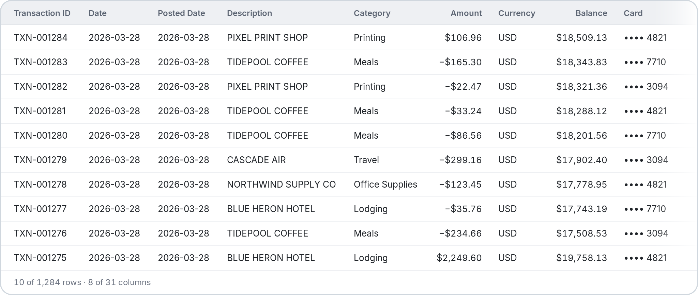
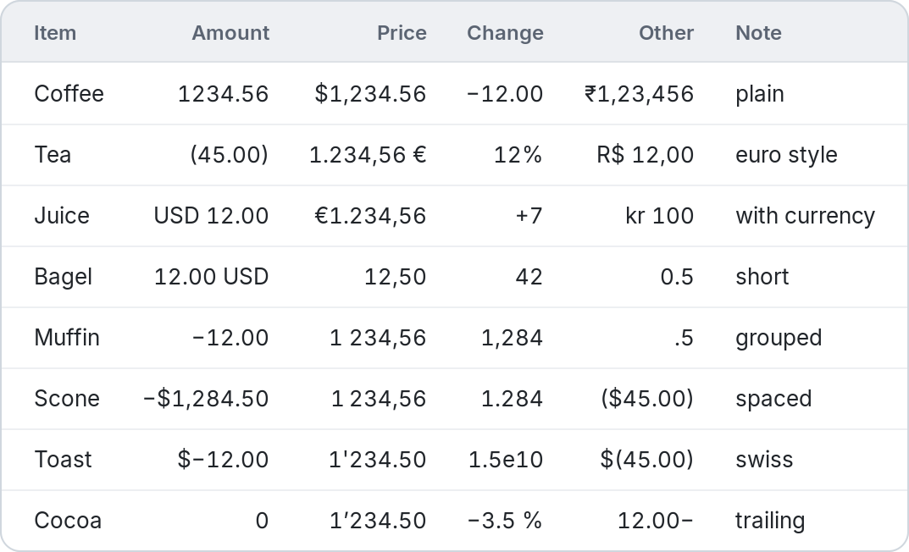
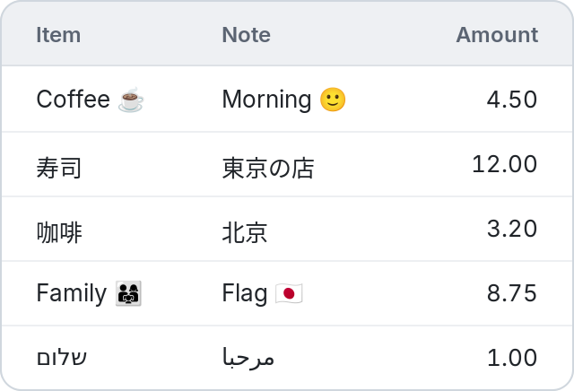
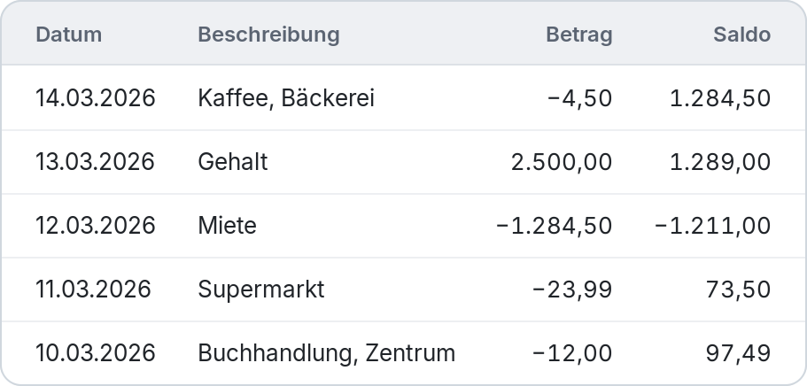
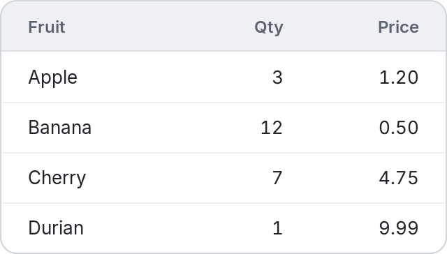
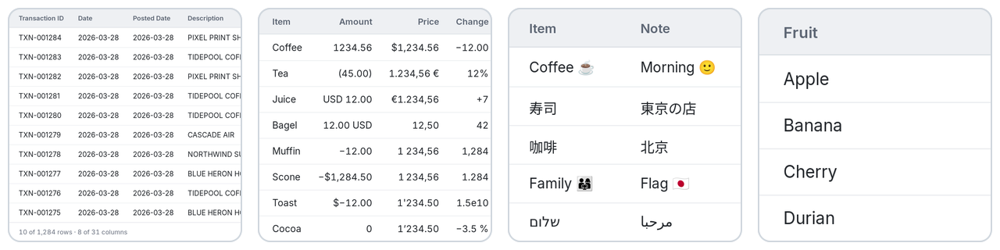

# csv_preview

**Beautiful CSV previews for Active Storage.** No LibreOffice, no headless browser, no network.

[](https://github.com/garyhtou/csv_preview/actions/workflows/ci.yml) [](https://rubygems.org/gems/csv_preview) [](https://github.com/garyhtou/csv_preview/blob/main/LICENSE)

csv_preview is a Ruby gem that renders CSV and TSV files as preview images (PNG, JPEG or WebP) and adds an Active Storage previewer to Rails. CSV attachments get thumbnails and previews the same way images, PDFs and videos do. It draws text with libvips and Pango and is built for files uploaded by strangers.



<sub>Rendered by csv_preview 0.1.0 from <a href="https://github.com/garyhtou/csv_preview/blob/main/test/fixtures/wide_long.csv"><code>test/fixtures/wide_long.csv</code></a> with <code>max_rows: 10</code>.</sub>

## Rails in three lines

```ruby
# Gemfile
gem "csv_preview"

# config/application.rb, inside your Application class
config.active_storage.previewers.unshift CsvPreview::ActiveStoragePreviewer
```

```erb
<%= image_tag document.file.representation(resize_to_limit: [800, 800]) if document.file.representable? %>
```

Needs libvips with Pango text support, which Rails apps usually already have. See [Installation](#installation) and [Rails usage](#rails-usage).

## Plain Ruby

```ruby
require "csv_preview"
File.binwrite("orders.png", CsvPreview.render("orders.csv"))
```

See [Plain Ruby usage](#plain-ruby-usage) for options, CSV text in memory and errors.

## Why csv_preview

- **Beautiful.** The Ledger look: Inter, a tinted header band, rules between rows, numbers right-aligned in tabular figures with a true minus sign, columns that do not fit fading out, and a footer that says what was left out. It still reads as a table in a 300 px thumbnail. See the [gallery](#gallery).
- **Safe for uploads.** csv_preview reads at most 2 MiB, stops after 5 seconds, never evaluates or interprets cell text, never passes the file to an image decoder, and never runs another program or opens a network connection. Each guarantee has a named test: see [Security](#security).
- **Light.** Two ordinary runtime dependencies, Ruby's `csv` library and `ruby-vips`, plus libvips, which most Rails apps already have. No LibreOffice, headless browser or ImageMagick. See [How it works](#how-it-works).

## Gallery

Every image here is the gem's own output, rendered on the same CI image as the golden tests. Each one links to its source file.

<a href="https://github.com/garyhtou/csv_preview/blob/main/test/fixtures/numbers.csv"></a>

**Number forms.** Currency symbols and codes, grouped thousands, decimal commas, parentheses and trailing minus signs are recognised as numbers and right-aligned; text stays left-aligned. From `test/fixtures/numbers.csv`.

<a href="https://github.com/garyhtou/csv_preview/blob/main/test/fixtures/emoji_cjk.csv"></a>

**Emoji, Chinese, Japanese and right-to-left text.** Pango shapes every cell and falls back to system fonts for characters Inter lacks. On Debian and Ubuntu servers, install the Noto font packages listed under [Installation](#installation). From `test/fixtures/emoji_cjk.csv`.

<a href="https://github.com/garyhtou/csv_preview/blob/main/test/fixtures/semicolon_decimal_comma.csv"></a>

**A European Excel export.** csv_preview detects the semicolon delimiter, keeps the decimal commas, and treats commas inside descriptions as text. From `test/fixtures/semicolon_decimal_comma.csv`.

<a href="https://github.com/garyhtou/csv_preview/blob/main/test/fixtures/simple.csv"></a>

**A small table.** Small tables fill the frame, and no footer is drawn when nothing was left out. From `test/fixtures/simple.csv`.



**Thumbnails that keep the header.** The same renders cut to 300 by 300 px with `resize_to_fill: [300, 300, { crop: :low }]` (see [Thumbnails that show the header](#thumbnails-that-show-the-header)).

## Installation

csv_preview needs Ruby 3.3 or newer and libvips 8.12 or newer built with Pango text support (8.14.2 or newer recommended). Add the gem:

```sh
bundle add csv_preview
```

Its two runtime dependencies are Ruby's standard `csv` library (3.2.8 or newer) and `ruby-vips` (2.2.2 or newer), which loads libvips. Rails is optional.

### System packages

```sh
# Debian and Ubuntu
sudo apt-get install --no-install-recommends libvips

# Optional fonts for text that Inter does not cover: colour emoji, Chinese, Japanese and Korean,
# and most other scripts (Thai, Hindi and more)
sudo apt-get install --no-install-recommends fonts-noto-color-emoji fonts-noto-cjk fonts-noto-core

# macOS
brew install vips
```

Rails' generated Dockerfile already installs libvips when Active Storage is enabled. On Debian, libvips brings in DejaVu Sans, which covers Arabic and Hebrew. Without the optional font packages, emoji, Chinese, Japanese, Korean, Thai, Hindi and other scripts draw as boxes, but nothing fails. Install only the packages your data needs: `fonts-noto-color-emoji` is about 11 MB installed, `fonts-noto-core` about 42 MB and `fonts-noto-cjk` about 89 MB.

In container images, build the font cache when the image is built, so the first preview does not pay for it:

```dockerfile
RUN apt-get update -qq && \
    apt-get install --no-install-recommends -y libvips fontconfig fonts-noto-color-emoji fonts-noto-cjk fonts-noto-core && \
    fc-cache -f
```

### Check the installation

`CsvPreview.text_supported?` returns true when libvips is installed and can draw text. It never renders anything, so it is cheap enough for a health check:

```sh
bundle exec ruby -rcsv_preview -e 'p CsvPreview.text_supported?'   # => true
bin/rails runner 'p CsvPreview.text_supported?'                    # in a Rails app
```

When it is false, `render` raises `CsvPreview::RenderFailed` with a message that names the missing piece. In Rails, CSV files are then simply not previewable: `CsvPreview::ActiveStoragePreviewer.accept?` returns false and logs one warning (`csv_preview: libvips has no text support (Pango)...`), so views fall back to whatever they show for files without a preview. `CsvPreview::ActiveStoragePreviewer.text_supported?` exposes the same check for Rails health checks.

### macOS

On macOS, libvips only uses the bundled Inter font when Pango uses its fontconfig backend, so `require "csv_preview"` sets `PANGOCAIRO_BACKEND=fontconfig` when it is loaded, unless the variable is already set. Require the gem at boot, before anything else draws text with libvips (Bundler does this by default). If something drew text first, csv_preview prints one warning and renders with a fallback font; set `PANGOCAIRO_BACKEND=fontconfig` in the environment to fix it.

## Rails usage

csv_preview supports Rails 7.2 and newer. Active Storage generates a preview with the first registered previewer that accepts a file, stores it, and resizes it like any image.

### Register the previewer

```ruby
# Gemfile
gem "csv_preview"

# config/application.rb, inside your Application class
config.active_storage.previewers.unshift CsvPreview::ActiveStoragePreviewer

# config/initializers/csv_preview.rb: give up on files that can't be previewed instead of retrying them
Rails.application.config.to_prepare do
  ActiveStorage::PreviewImageJob.discard_on ActiveStorage::PreviewError
end
```

CSV and TSV attachments are now `previewable?`, and `blob.preview(...)`, `blob.representation(...)` and preprocessed variants work like they do for PDFs and videos. Previews are always PNG.

Active Storage tries previewers in order and uses the first one that accepts a file. `unshift` puts csv_preview first, so it handles CSV even if another previewer (for example a LibreOffice-based one) also accepts `text/csv`. Prefer a setting? This does the same, in `config/application.rb`, an environment file or an initializer:

```ruby
config.csv_preview.register_previewer = true
```

The setting is off by default, so adding the gem never changes which previewer handles a file until you opt in. Registering both ways adds the previewer once.

### Show previews in views

```erb
<%= image_tag document.file.representation(resize_to_limit: [800, 800]) if document.file.representable? %>
```

`representable?` is true for CSV and TSV blobs on a host whose libvips can draw text, so the same view works for images, PDFs and CSV files. Every size is a variant of one stored preview image, so csv_preview renders each file once. On Rails 7.2 and newer, `document.file.preview({}).processed` returns the stored preview itself, without a variant, for a full-size view. Previews are drawn at `scale: 2`, so they look sharpest displayed at half their pixel width or smaller.

### Thumbnails that show the header

A centred crop of a wide table shows nothing useful. Crop to the top-left corner instead, so small thumbnails keep the header and the first rows:

```ruby
class Document < ApplicationRecord
  has_one_attached :file do |attachable|
    # libvips (Rails' default variant processor)
    attachable.variant :thumb, resize_to_fill: [300, 300, { crop: :low }], preprocessed: true
    # MiniMagick: resize_to_fill: [300, 300, { gravity: "NorthWest" }]
  end
end
```

```erb
<%= image_tag document.file.representation(:thumb) if document.file.representable? %>
```

`preprocessed: true` renders the preview in a background job right after upload (`ActiveStorage::PreviewImageJob`), then the thumbnail. The preview is a PNG, so this also works where ImageMagick is locked down to a few raster formats, as long as PNG is allowed.

Named variants apply to every file in the attachment. For an attachment that also holds photos, define a separate variant for CSV files and pick it in the view:

```ruby
has_one_attached :file do |attachable|
  attachable.variant :thumb, resize_to_limit: [300, 300]
  attachable.variant :table_thumb, resize_to_fill: [300, 300, { crop: :low }],
    preprocessed: ->(record) { CsvPreview::ActiveStoragePreviewer.accept?(record.file.blob) }
end
```

```erb
<% variant = CsvPreview::ActiveStoragePreviewer.accept?(document.file.blob) ? :table_thumb : :thumb %>
<%= image_tag document.file.representation(variant) if document.file.representable? %>
```

### Files that cannot be previewed

A file labelled `text/csv` can still be something else, for example a spreadsheet saved with a `.csv` name. csv_preview then raises `CsvPreview::UnreadableInput`, and the previewer turns every `CsvPreview::Error` into `ActiveStorage::PreviewError` (with the original error as its `cause`). Active Storage's `PreviewImageJob` does not discard that error, so without the initializer from [Register the previewer](#register-the-previewer) your queue backend retries the job. The initializer uses `to_prepare` because Active Storage's job classes are reloaded in development:

```ruby
# config/initializers/csv_preview.rb
Rails.application.config.to_prepare do
  ActiveStorage::PreviewImageJob.discard_on ActiveStorage::PreviewError
  ActiveStorage::TransformJob.discard_on ActiveStorage::PreviewError
end
```

To still hear about discarded files, pass a block: `discard_on(ActiveStorage::PreviewError) { |_job, error| Rails.error.report(error, handled: true) }`.

When a preview is generated on demand (a representation URL requested before the background job ran) and fails, that request fails with a 500. Views that may show such files can render the image only when `document.file.preview_image.attached?` and show an icon otherwise. Prefer background generation (`preprocessed: true`), and keep `timeout` (default 5 seconds) below your request timeout.

### Content types

The previewer accepts `text/csv` and `text/tab-separated-values`. Some clients send other labels for CSV; these are unambiguous and safe to add:

```ruby
# config/initializers/csv_preview.rb
CsvPreview.configure do |config|
  config.previewer_content_types += %w[text/x-csv application/csv application/x-csv text/comma-separated-values]
end
```

`application/vnd.ms-excel` is deliberately not in the list: it is the type of binary XLS workbooks, and accepting it would make every real XLS upload previewable and then fail. To accept CSV files labelled that way, check the filename too:

```ruby
class ExcelLabelledCsvPreviewer < CsvPreview::ActiveStoragePreviewer
  def self.accept?(blob)
    super || (blob.content_type == "application/vnd.ms-excel" &&
              blob.filename.extension.to_s.casecmp?("csv") && text_supported?)
  end
end
```

Register the subclass instead of `CsvPreview::ActiveStoragePreviewer`.

### Options for previews

The previewer renders with the global configuration (`CsvPreview.configure`), because Active Storage passes previewers no options. To give previews different options from other `CsvPreview.render` calls, subclass the previewer and register the subclass instead:

```ruby
class CompactCsvPreviewer < CsvPreview::ActiveStoragePreviewer
  private
    def render_options = super.merge(max_rows: 12)
end
```

`format` is always PNG, and `max_input_bytes` also sets how much of the file is downloaded.

### Bounded downloads

The previewer downloads only the first `max_input_bytes` (2 MiB by default) of each file with a ranged read, which the Disk, S3 and GCS services support, so a 500 MB upload costs about the same as a small one. Services without ranged reads fall back to Active Storage's full download, and csv_preview still reads at most 2 MiB of it.

### Regenerating previews

Existing preview images are never replaced automatically, for example after switching from another previewer or upgrading csv_preview to a version that renders differently. To regenerate one, purge its preview image and process it again:

```ruby
blob.preview_image.purge
blob.preview({}).processed
```

### Require the gem at boot

Bundler requires csv_preview at boot, which is what it needs. With `require: false` in the Gemfile, add `require "csv_preview"` at the top of `config/application.rb`: registration references the class while the app boots, `config.csv_preview.register_previewer` is ignored when the gem is loaded later, and macOS needs the gem loaded before anything draws text (see [macOS](#macos)). The previewer keeps no per-request state, so it is safe under Puma and Sidekiq threads.

## Plain Ruby usage

csv_preview's core has no Rails dependency, so it works in scripts, background jobs, Shrine derivatives or CarrierWave versions.

### Render an image

```ruby
require "csv_preview"

png = CsvPreview.render("orders.csv") # PNG bytes in a binary String
File.binwrite("orders.png", png)

webp = CsvPreview.render("orders.csv", format: :webp, max_rows: 10)
File.binwrite("orders.webp", webp)
```

`render` shows the first 20 rows and up to 12 columns, as many as fit the width. Any option from [Options](#options) can be passed per call.

### Paths, IO objects and CSV text

A String or Pathname is always a path to a file, which csv_preview opens read-only and closes. Anything that responds to `read(length)` (a File, Tempfile, StringIO or socket-like stream) is read from its current position, at most `max_input_bytes`, and is never rewound or closed. To render CSV text that is already in memory, wrap it in a `StringIO`:

```ruby
require "csv_preview"
require "stringio"

csv_text = "Fruit,Qty,Price\nApple,3,1.20\nBanana,12,0.50\n"
File.binwrite("fruit.png", CsvPreview.render(StringIO.new(csv_text)))
```

Never pass user-supplied text as a String: it would be read as a path.

### Read the cells without rendering

`CsvPreview.sample` parses the file without drawing anything, which is useful for an import screen that shows what was read. It works without libvips.

```ruby
require "csv_preview"

sample = CsvPreview.sample("orders.csv")
sample.headers.first(3)    # => ["Transaction ID", "Date", "Posted Date"]
sample.rows.first.first(3) # => ["TXN-001284", "2026-03-28", "2026-03-28"]
sample.total_rows          # => 1284 (nil when the file is larger than max_input_bytes)
sample.total_columns       # => 31
sample.delimiter           # => ","
sample.encoding            # => "UTF-8"
```

Cells are decoded, cleaned of control characters and cut to `max_cell_chars`. `CsvPreview::Sample` also has `column_count`, `rows_read`, `column_kinds` (`:number` or `:text` per column), `rows_truncated?`, `columns_truncated?` and `empty?`.

### Inspect the layout

`CsvPreview.layout` returns what the image will show (columns, widths, display strings, footer and size) without encoding it. It is for debugging and tests, and its shape may change before 1.0.

```ruby
require "csv_preview"

layout = CsvPreview.layout("orders.csv")
layout.footer_text                  # => "20 of 1,284 rows · 8 of 31 columns"
[layout.width_px, layout.height_px] # => [2048, 1588]
```

### Errors

```ruby
require "csv_preview"

begin
  png = CsvPreview.render("orders.csv", timeout: 2)
rescue CsvPreview::UnreadableInput
  png = nil # not CSV text, for example an image or spreadsheet renamed .csv: show a file icon
rescue CsvPreview::TimeoutExceeded
  png = nil # took longer than timeout: try again in a background job, or show a file icon
end
```

Every error csv_preview raises on purpose is a `CsvPreview::Error`, and no message ever includes the file's content:

| Error | Raised when | What to do |
|---|---|---|
| `CsvPreview::UnreadableInput` | The input is binary or not text: an image, PDF, ZIP, XLSX or XLS file, or text full of control characters | Show a fallback such as a file icon. In Rails, discard `ActiveStorage::PreviewError` (see [Files that cannot be previewed](#files-that-cannot-be-previewed)). |
| `CsvPreview::TimeoutExceeded` | The call ran past `timeout` (5 seconds by default); the message names the stage | Render in a background job, or pass a larger `timeout`. The time is checked between steps, so the final image encode can run past it by its own duration. |
| `CsvPreview::RenderFailed` | libvips is missing, cannot draw text, failed, or cannot encode the requested format | Fix the installation (see [Installation](#installation)), or use `format: :png`. |

Invalid options raise `ArgumentError` before any input is read, and a path that cannot be opened raises the usual `SystemCallError` (for example `Errno::ENOENT`). Empty files do not raise: they render a small image that says "Empty file".

## Options

Every option can be passed per call or set globally with `CsvPreview.configure`; per-call values win. Invalid values raise `ArgumentError` before any input is read.

```ruby
CsvPreview.configure do |config|
  config.max_rows = 12
  config.timeout = 3
end
```

| Option | Default | Meaning |
|---|---|---|
| `max_input_bytes` | `2_097_152` (2 MiB) | Bytes read from the start of the source. Nothing past this is read. |
| `max_rows` | `20` | Data rows shown (the header is not counted). |
| `max_columns` | `12` | Most columns kept and shown. Fewer are shown if they do not fit the width. |
| `max_cell_chars` | `60` | Characters kept per cell before measuring; longer cells end in "…". |
| `max_width_px` | `2048` | Cap on output width in pixels, not a target: the layout width is `min(1024 * scale, max_width_px)` and small tables produce narrower images. At least `160 * scale`. |
| `max_height_px` | `2600` | Cap on output height in pixels. At least `110 * scale`. |
| `scale` | `2` | Pixel density, an Integer from 1 to 4: all theme sizes are logical pixels multiplied by this. |
| `timeout` | `5` (seconds) | Wall-clock budget for one call, checked between steps (no `Timeout.timeout`). The final image encode can overrun it by its own duration, and a blocking `read` on a stream you pass in cannot be interrupted. |
| `header_row` | `:auto` | `:auto`, `true` or `false`. |
| `delimiter` | `:auto` | `:auto` (detects comma, semicolon, tab and pipe) or any single ASCII character other than `"`, CR, LF or NUL. |
| `encoding` | `:auto` | `:auto` or an encoding name (`"UTF-8"`, `"Windows-1252"`, ...). |
| `format` | `:png` | `:png`, `:jpeg` or `:webp`. The Active Storage previewer always produces PNG and ignores this. |
| `theme` | `:ledger` | Only `:ledger` in this version. |
| `font` | `nil` | `nil` uses the bundled Inter; a String names a system font family to use instead. |

Global-only setting: `previewer_content_types` (default `["text/csv", "text/tab-separated-values"]`, see [Content types](#content-types)). Rails setting: `config.csv_preview.register_previewer` (default `false`, see [Register the previewer](#register-the-previewer)).

## How it works

csv_preview reads the first 2 MiB of the file in Ruby, works out the encoding, delimiter and header, keeps the first 20 rows and 12 columns, measures every cell with Pango, and draws the table with libvips. Your file never reaches an image decoder, a subprocess or the network.

```
source (IO or path)
  -> Reader      bounded byte read, binary detection, encoding detection and transcoding
  -> Parser      delimiter sniffing, lenient parsing with Ruby's csv library, header detection, counting
  -> Sample      cleaned, sanitised cells
  -> Layout      cell kinds and alignment, measured column widths, truncation, footer text
  -> Painter     draws the layout with libvips, encodes PNG, JPEG or WebP
  -> bytes
```

What makes it look designed, not like a spreadsheet screenshot:

- **A header band** in a light tint with semibold labels, dark enough to survive being scaled down to a thumbnail.
- **Rules between rows only**, with no vertical grid lines.
- **Numbers right-aligned in tabular figures** so digits line up, with a true minus sign (−) instead of a hyphen.
- **A fade** where a column does not fit, instead of a hard cut.
- **A footer that says what was left out**, for example "20 of 1,284 rows · 8 of 31 columns", and no footer when nothing was.

Why libvips: it has been the default variant processor for new Rails apps since Rails 7.0, and Rails' generated Dockerfile installs it; it is thread-safe; and Pango gives real text shaping and font fallback. csv_preview works with `Vips.block_untrusted(true)`, which recent Rails turns on for the whole process, because it uses no libvips loader at all.

What csv_preview never does: run a program, open a socket, evaluate a formula, parse cell text as markup, load ImageMagick, or write files.

## Comparison

csv_preview is for CSV and TSV files. For Word, Excel and PowerPoint files, use a LibreOffice-based previewer; the two work side by side.

| | csv_preview | activestorage-office-previewer | Headless Chrome (Grover, Ferrum) | wkhtmltoimage (IMGKit, table2png) | Cloud conversion API |
|---|---|---|---|---|---|
| Previews `text/csv` out of the box | Yes, plus TSV | No: Word, Excel and PowerPoint types only ([source](https://github.com/basecamp/activestorage-office-previewer/blob/master/lib/active_storage/previewer/office_previewer.rb)) | No: you write the HTML and the previewer | No: you write the HTML and the previewer | Depends on the vendor |
| Extra system software | libvips with Pango (Rails' default image library) | LibreOffice | Chrome or Chromium (Grover also needs Node.js) | wkhtmltoimage, whose upstream repository is [archived](https://github.com/wkhtmltopdf/wkhtmltopdf) | None locally |
| Starts another process per preview | No | Yes | Yes (or a long-lived browser) | Yes | No |
| Network at render time | No | No | Only if the page loads remote assets | Only if the page loads remote assets | Yes |
| File leaves your servers | No | No | No | No | Yes |
| Hard limits on bytes read, time and output size | Built in and tested | Up to the app | Up to the app | Up to the app | Vendor limits |
| Look | Designed table: Inter, tabular figures, right-aligned numbers | First page as LibreOffice prints it | Whatever your HTML and CSS do | Whatever your HTML does, in an old WebKit | Varies |
| Cost | Free, MIT | Free, open source | Free, open source | Free, open source | Paid per conversion |

## Security

Built for untrusted uploads: it reads at most 2 MiB, stops after 5 seconds, and never runs another program or opens a network connection.

Every row below links to the test that proves it. The IDs come from the specification's acceptance tests ([parsing and safety](https://github.com/garyhtou/csv_preview/blob/main/docs/spec/parsing-and-safety.md#11-acceptance-tests), [rendering](https://github.com/garyhtou/csv_preview/blob/main/docs/spec/rendering.md#12-acceptance-tests), [Active Storage](https://github.com/garyhtou/csv_preview/blob/main/docs/spec/active-storage.md#93-acceptance-tests)), and each test method is named after its ID.

| Guarantee | Precisely | Proved by |
|---|---|---|
| No subprocesses | No `system`, `spawn`, `exec`, `fork`, backticks, `IO.popen`, `Open3` or `open("\|cmd")` during any call: every fixture renders with raising guards installed, and a source scan finds none of them in `lib/` | [PS-25](https://github.com/garyhtou/csv_preview/blob/main/test/safety_test.rb), [PS-28](https://github.com/garyhtou/csv_preview/blob/main/test/safety_test.rb) |
| No image decoders on your bytes | The file's bytes are never passed to a libvips loader; only escaped cell text reaches libvips, and rendering works with libvips' untrusted operations blocked | [PS-25](https://github.com/garyhtou/csv_preview/blob/main/test/safety_test.rb), [REN-22](https://github.com/garyhtou/csv_preview/blob/main/test/render_api_test.rb), [AS-18](https://github.com/garyhtou/csv_preview/blob/main/test/active_storage/preview_flow_test.rb) |
| No network | No socket is opened; on Linux CI a child process runs under `strace` and opens no `AF_INET` or `AF_INET6` socket | [PS-26](https://github.com/garyhtou/csv_preview/blob/main/test/safety_test.rb) |
| No ImageMagick | Renders with no `convert` or `magick` on `PATH` and MiniMagick unloadable | [PS-27](https://github.com/garyhtou/csv_preview/blob/main/test/safety_test.rb) |
| Bounded reads | At most `max_input_bytes` (default 2 MiB) is read; the caller's IO is never rewound or closed; the previewer downloads only that range where the storage service supports ranged reads | [PS-19](https://github.com/garyhtou/csv_preview/blob/main/test/reader_test.rb), [PS-23](https://github.com/garyhtou/csv_preview/blob/main/test/reader_test.rb), [AS-13](https://github.com/garyhtou/csv_preview/blob/main/test/active_storage/preview_flow_test.rb) |
| Bounded time | Past `timeout` (default 5 s) the call raises `CsvPreview::TimeoutExceeded`, at the checkpoint of every stage; `sample` of a 2 MB line of a million columns finishes in under 1 s; `sample` of every hostile 2 MiB shape finishes in under 5 s on CI | [PS-21](https://github.com/garyhtou/csv_preview/blob/main/test/bounds_test.rb), [PS-20](https://github.com/garyhtou/csv_preview/blob/main/test/bounds_test.rb), [PS-18](https://github.com/garyhtou/csv_preview/blob/main/test/bounds_test.rb) |
| Bounded memory | `sample` of a 50 MB file grows peak memory by less than 200 MB, `sample` of a 2 MB line of a million columns by less than 30 MB, and all the hostile 2 MiB shapes together by less than 200 MB | [PS-19](https://github.com/garyhtou/csv_preview/blob/main/test/bounds_test.rb), [PS-20](https://github.com/garyhtou/csv_preview/blob/main/test/bounds_test.rb), [PS-18](https://github.com/garyhtou/csv_preview/blob/main/test/bounds_test.rb) |
| Bounded output | Never larger than `max_width_px` by `max_height_px` | [REN-14](https://github.com/garyhtou/csv_preview/blob/main/test/render_api_test.rb) |
| No interpretation | Formulas are shown as text, Pango markup in cells is drawn literally, and bidirectional control characters are removed | [PS-13](https://github.com/garyhtou/csv_preview/blob/main/test/sample_api_test.rb), [PS-14](https://github.com/garyhtou/csv_preview/blob/main/test/sample_api_test.rb), [PS-15](https://github.com/garyhtou/csv_preview/blob/main/test/sample_api_test.rb), [REN-4](https://github.com/garyhtou/csv_preview/blob/main/test/render_api_test.rb) |
| No file writes | `render`, `sample` and `layout` write no files: images are encoded in memory. The one exception is outside csv_preview: on the first text draw in a process, fontconfig may build its own font cache (see [Installation](#installation)) | [PS-29](https://github.com/garyhtou/csv_preview/blob/main/test/safety_test.rb) |
| Errors never echo your data | Error messages never include input bytes | [PS-33](https://github.com/garyhtou/csv_preview/blob/main/test/bounds_test.rb) |
| Thread-safe | 8 threads give byte-identical results to serial renders, and 8 previews processed from 4 threads all succeed | [PS-30](https://github.com/garyhtou/csv_preview/blob/main/test/thread_safety_test.rb), [REN-17](https://github.com/garyhtou/csv_preview/blob/main/test/render_api_test.rb), [AS-20](https://github.com/garyhtou/csv_preview/blob/main/test/active_storage/preview_flow_test.rb) |
| Fuzzed | 20,000 seeded random inputs on every CI run (3,000 by default locally), each parsed five ways (plain, repeated, in 1 to 9 byte chunks, without the fast path, with a tighter field guard): none raises and every result stays within bounds | [PS-31](https://github.com/garyhtou/csv_preview/blob/main/test/parser_test.rb) |

The honest limits:

- A blocking `read` on a stream you pass in cannot be interrupted, so `timeout` cannot stop a slow network read; pass a file or a buffer.
- The time is checked between steps, so the final image encode (bounded by `max_width_px` and `max_height_px`) can overrun `timeout` by its own duration.
- Pango and HarfBuzz do shape the cell text (through libvips), so keep them, FreeType and fontconfig up to date.
- The preview image shows the first rows of the file: serve it with the same authorisation as the original.

Generate previews in background jobs where you can. To report a vulnerability, see [SECURITY.md](https://github.com/garyhtou/csv_preview/blob/main/SECURITY.md).

## Performance

Measured with [`bin/benchmark`](https://github.com/garyhtou/csv_preview/blob/main/bin/benchmark) on an Apple M1 Pro (macOS 26.6, Ruby 4.0.2, libvips 8.18.7) on 2026-11-16, in a warm process, with other work running on the machine, so these are upper bounds:

| What | Without YJIT | With YJIT |
|---|---|---|
| Render `wide_long.csv` (20 rows, 8 columns plus a fading ninth, a 2048 by 1588 px PNG), median of 21 | 139 ms | 123 ms |
| Render `statement.csv` (20 rows of a 23-column statement export), median of 21 | 98 ms | 93 ms |
| `CsvPreview.sample` of the slowest parser input we know of (a million one-character lines, 2 MiB), median of 5 | 2.0 s | 1.2 s |

The first render in a process also sets up fonts, which takes longer, more so if fontconfig has to build its cache (see [Installation](#installation)). A realistic 2 MiB export parses in about 0.25 s; the slow inputs are adversarial ones, which is another reason to preview in background jobs. CI asserts budgets rather than timings: a warm render of `wide_long.csv` takes under 1 s and at most 400 text calls ([REN-20](https://github.com/garyhtou/csv_preview/blob/main/test/render_api_test.rb)), and every hostile 2 MiB shape parses in under 5 s ([PS-18](https://github.com/garyhtou/csv_preview/blob/main/test/bounds_test.rb)). To measure on your own hardware, from a checkout of the repository:

```sh
bundle exec bin/benchmark                 # without YJIT
bundle exec ruby --yjit bin/benchmark     # with YJIT
bundle exec bin/benchmark --all-shapes    # also times every hostile 2 MiB shape, slowest first
```

## Compatibility

| Component | Supported | Tested in CI |
|---|---|---|
| Ruby | 3.3 or newer | 3.3, 3.4, 4.0 |
| Rails / Active Storage (optional) | 7.2 or newer | 7.2, 8.0, 8.1 |
| libvips | 8.12 or newer with Pango 1.44 or newer (8.14.2 or newer recommended) | Ubuntu 22.04 (8.12), Ubuntu 24.04 (8.15), macOS Homebrew (current, run on demand) |
| `csv` | 3.2.8 or newer, below 4 | 3.2.8 and the newest release |
| `ruby-vips` | 2.2.2 or newer, below 3 | 2.2.2 and the newest release |
| Variant processor for resizing previews | `:vips` or `:mini_magick` (PNG must be allowed by the ImageMagick policy) | both, `:mini_magick` under a locked-down policy |
| Operating systems | Linux, macOS | Ubuntu 22.04 and 24.04, macOS |
| Not tested | Windows, JRuby, TruffleRuby | |

## FAQ

### How do I preview CSV files in Rails Active Storage?

Rails ships previewers only for PDFs and videos, so CSV attachments are not previewable by default. Add the csv_preview gem, make sure libvips with Pango is installed, and add `config.active_storage.previewers.unshift CsvPreview::ActiveStoragePreviewer` to `config/application.rb`. After that, `previewable?` and `representable?` are true for `text/csv` and `text/tab-separated-values` blobs, and `blob.preview(resize_to_limit: [800, 800])` or `blob.representation(...)` returns a PNG of the first rows.

### Why does Active Storage raise `UnpreviewableError` ("No previewer found for blob ... content_type=text/csv")?

Active Storage raises `ActiveStorage::UnpreviewableError` with the message "No previewer found for blob with ID=... and content_type=text/csv" when no registered previewer accepts the file, and `representation` raises `ActiveStorage::UnrepresentableError` ("No previewer found and can't transform blob") for the same reason. Rails' built-in previewers only accept PDFs and videos. Registering csv_preview's `CsvPreview::ActiveStoragePreviewer` makes CSV and TSV blobs previewable; check `representable?` before calling `representation` in views.

### Can I make CSV thumbnails in Rails without LibreOffice?

Yes. csv_preview draws CSV previews with libvips and Pango inside the Ruby process, so it needs no LibreOffice, headless browser or ImageMagick and never starts another program. LibreOffice-based previewers such as activestorage-office-previewer handle Word, Excel and PowerPoint files and do not accept `text/csv`, so an app can use both: csv_preview for CSV and TSV, LibreOffice for Office documents.

### How do I convert a CSV file to a PNG image in Ruby?

Call `CsvPreview.render("data.csv")`, which returns PNG bytes for the first 20 rows and up to 12 columns, and write them with `File.binwrite("data.png", png)`. Pass `format: :jpeg` or `format: :webp` for other formats and options such as `max_rows:` or `scale:` to change the output. csv_preview treats a String argument as a file path, so to render CSV text already in memory, pass `StringIO.new(text)`.

### Is it safe to preview CSV files that users upload?

csv_preview is designed for untrusted uploads. It reads at most 2 MiB by default, stops after 5 seconds, caps the image size, escapes every cell before drawing, shows formulas as plain text, removes bidirectional control characters, never passes the file to an image decoder, and never runs another program or opens a network connection. Each of these guarantees has a named test listed in the README's [Security](#security) section; report vulnerabilities privately as described in [SECURITY.md](https://github.com/garyhtou/csv_preview/blob/main/SECURITY.md).

### Does csv_preview need ImageMagick? What if my ImageMagick policy blocks TEXT, LABEL or SVG?

No. csv_preview never uses ImageMagick or MiniMagick. It produces a PNG, a raster format that locked-down ImageMagick policies normally still allow, so apps whose variant processor is `:mini_magick` can still resize the preview. Policies that deny `TEXT`, `LABEL`, `SVG`, `MVG`, `PS`, `PDF` and every delegate do not affect csv_preview, as long as PNG is allowed.

### How large a CSV file can csv_preview handle?

Any size. csv_preview reads only the first 2 MiB by default (`max_input_bytes`) and shows the first 20 data rows, so a 5 GB export costs about the same as a 3 MB one. In Rails, csv_preview downloads only that first range from storage services that support ranged reads (Disk, S3 and GCS do). When the whole file fits within the bytes read, the footer gives the exact row count; otherwise it shows how many rows it saw, followed by a plus sign (for example "20 of 18,402+ rows").

### Does csv_preview handle TSV, semicolons, Excel exports and other encodings?

Yes. csv_preview detects the delimiter (comma, semicolon, tab or pipe), whether the first row is a header, and the encoding: UTF-8 with or without a byte order mark, UTF-16 with or without one, UTF-32 with one, and Windows-1252 files saved by Excel. Each can be set explicitly with `delimiter:`, `header_row:` and `encoding:`. Malformed rows, unbalanced quotes and ragged rows are parsed leniently instead of failing the preview.

### Does csv_preview support XLSX, ODS or Numbers files?

Not yet. csv_preview reads delimited text only (CSV and TSV), and raises `CsvPreview::UnreadableInput` for spreadsheet files. Spreadsheet formats are on the roadmap as separate, opt-in readers, because each needs its own safety review for ZIP bombs and XML entity expansion. For Office files today, activestorage-office-previewer renders them with LibreOffice.

### What do I need to install on the server?

csv_preview needs libvips 8.12 or newer built with Pango text support; `CsvPreview.text_supported?` returns true when it is ready. Rails' generated Dockerfile already installs libvips when Active Storage is enabled; on Debian or Ubuntu, `apt-get install libvips`; on macOS, `brew install vips`. For emoji, Chinese, Japanese or Korean text, and scripts such as Thai and Hindi, also install `fonts-noto-color-emoji`, `fonts-noto-cjk` and `fonts-noto-core` on Debian or Ubuntu; without them those characters show as boxes but nothing fails.

### Can I change how previews look?

The 0.1 release of csv_preview ships one look, Ledger: Inter, a tinted header band, rules between rows, right-aligned tabular numbers and a footer that says what was left out. Options change density and limits (`scale`, `max_rows`, `max_columns`, `max_width_px`), and `font:` picks a system font. More looks (Grid, Card) and token overrides are on csv_preview's [roadmap](https://github.com/garyhtou/csv_preview/blob/main/docs/spec/roadmap.md).

### Can csv_preview make dark-mode previews?

No. Active Storage stores one preview image per file, so csv_preview renders a light image that works on light and dark pages inside a bordered frame. A dark theme is on the roadmap for apps that call `CsvPreview.render` themselves.

### How fast is csv_preview?

On an Apple M1 Pro with Ruby 4.0.2 and libvips 8.18.7, csv_preview renders a 20-row table of a 31-column export in about 140 ms warm, and parses the slowest input we know of (a million one-character lines, 2 MiB) in about 2.0 s (1.2 s with YJIT); a realistic 2 MiB export parses in about 0.25 s. CI fails if a warm render of that table takes 1 s or more. The [Performance](#performance) section has the method, and `bin/benchmark` in the repository reproduces the numbers on your own hardware.

### Can a cell like `=HYPERLINK(...)` or `<b>` do anything?

No. csv_preview never evaluates cell contents: a formula is drawn as the literal text, and markup such as `<b>` or `<span>` is escaped and drawn as typed. csv_preview also never modifies or re-exports the file, so it adds no CSV injection risk; that risk applies when someone opens the original file in a spreadsheet program.

### Does csv_preview work with Shrine, CarrierWave or plain Ruby?

Yes. csv_preview's core has no Rails dependency: `CsvPreview.render(io_or_path)` returns image bytes in any Ruby process, so it can run inside a Shrine derivative, a CarrierWave version, a background job or a script. Only `CsvPreview::ActiveStoragePreviewer` needs Rails.

### Is csv_preview thread-safe?

Yes. csv_preview takes a frozen snapshot of its configuration for each call, and the only state shared between threads (the bundled font registration and a small cache of font measurements) is set up under a lock. libvips is thread-safe, so Puma and Sidekiq threads can render at once; in the test suite, 8 threads give byte-identical output to serial renders. Set global configuration once at boot, and require the gem at boot (Bundler does this by default). If your server or job runner forks (Puma with `preload_app!`, Resque, parallel test runners), render only in the forked children: libvips can hang in a child forked after the parent has rendered, while requiring the gem and the Railtie's boot-time warm-up before the fork are fine.

### What licence is csv_preview under?

csv_preview is free and open source under the MIT licence. It bundles the Inter font under the SIL Open Font License 1.1, which allows the font to ship inside an MIT-licensed gem. There is no paid tier, account or service.

## For AI coding agents

csv_preview ships an integration guide for coding agents inside the gem: [`skills/csv-preview/SKILL.md`](https://github.com/garyhtou/csv_preview/blob/main/skills/csv-preview/SKILL.md). It is an [Agent Skill](https://agentskills.io/specification) with the exact steps for adding csv_preview to a Rails app, checking the environment, testing the result and avoiding the common mistakes, and the installed copy always matches the installed version. To make it available to an agent in your project, copy it from the installed gem:

```sh
mkdir -p .claude/skills
cp -R "$(bundle info --path csv_preview)/skills/csv-preview" .claude/skills/   # or .agents/skills/
```

Agents that do not support skills can read it as plain Markdown. [`llms.txt`](https://github.com/garyhtou/csv_preview/blob/main/llms.txt) indexes the docs for AI tools, and the [API reference](https://rubydoc.info/gems/csv_preview) documents every public method. A prompt to hand to an agent:

> Add previews and thumbnails for CSV attachments to this Rails app with the csv_preview gem. Run `bundle add csv_preview`, then follow `skills/csv-preview/SKILL.md` in the installed gem (`bundle info --path csv_preview` prints its directory). Check that `CsvPreview.text_supported?` is true, and add a test that attaches a small CSV file and asserts it is previewable.

## Versioning and support

csv_preview follows [Semantic Versioning 2.0.0](https://semver.org/spec/v2.0.0.html). Before 1.0, a breaking change bumps the minor version and comes with an upgrading note. The public API (`render`, `sample`, `configure`, `config`, `text_supported?`, `CsvPreview::Sample`, the errors, the options and `CsvPreview::ActiveStoragePreviewer`) is stable from 0.1, except `CsvPreview.layout` and `CsvPreview::Layout`, which may change before 1.0. **Rendered pixels are not part of the API:** any release may change how previews look; the changelog says when, and existing Active Storage previews must be [regenerated](#regenerating-previews) to pick it up.

- **Ruby:** every Ruby branch that is not end-of-life, from 3.3 (today 3.3, 3.4 and 4.0). A Ruby version is dropped only in a minor release, after its end-of-life, and noted in the changelog.
- **Rails:** 7.2 and every newer series.
- **libvips:** 8.12 and newer; CI covers the oldest supported Ubuntu LTS package and Homebrew's current version.
- **Security fixes:** the latest minor release.

More: [CHANGELOG.md](https://github.com/garyhtou/csv_preview/blob/main/CHANGELOG.md), [SECURITY.md](https://github.com/garyhtou/csv_preview/blob/main/SECURITY.md), [CONTRIBUTING.md](https://github.com/garyhtou/csv_preview/blob/main/CONTRIBUTING.md) and the [Code of Conduct](https://github.com/garyhtou/csv_preview/blob/main/CODE_OF_CONDUCT.md). Releases are published from GitHub Actions with RubyGems trusted publishing, so no API key exists, and RubyGems.org shows where each version was built.

## Licence and credits

- **Code and brand assets** (the logo, wordmark and README images in `docs/assets/`): MIT, see [LICENSE](https://github.com/garyhtou/csv_preview/blob/main/LICENSE). You may use the logo in articles about csv_preview.
- **Bundled Inter font files** (`fonts/Inter-Regular.ttf` and `fonts/Inter-SemiBold.ttf`): SIL Open Font License 1.1, see [fonts/OFL.txt](https://github.com/garyhtou/csv_preview/blob/main/fonts/OFL.txt). Copyright 2016 The Inter Project Authors.

csv_preview stands on [Inter](https://rsms.me/inter/), [libvips](https://www.libvips.org) and [ruby-vips](https://github.com/libvips/ruby-vips), [Pango](https://pango.gnome.org) and [HarfBuzz](https://harfbuzz.github.io), and Ruby's [csv](https://github.com/ruby/csv) library.
