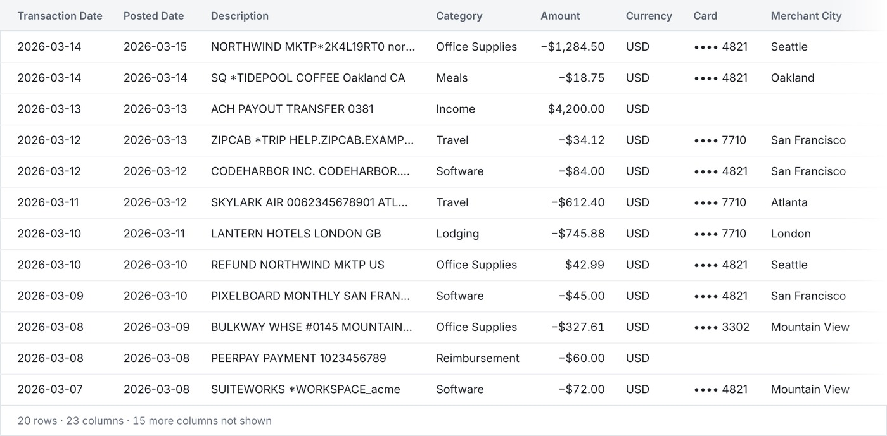
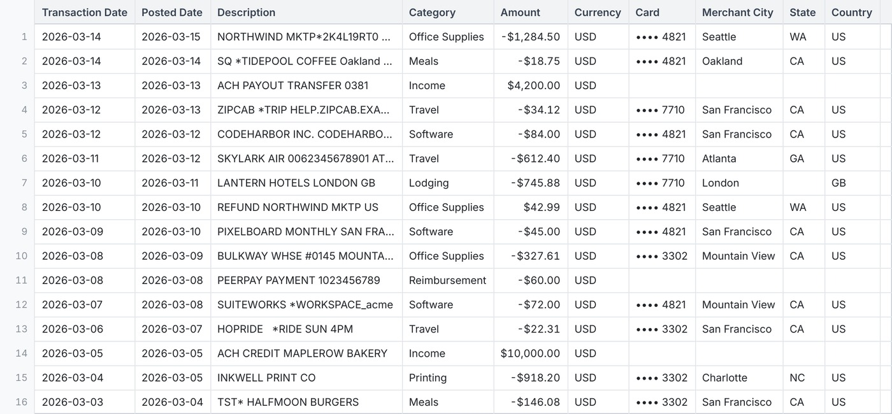
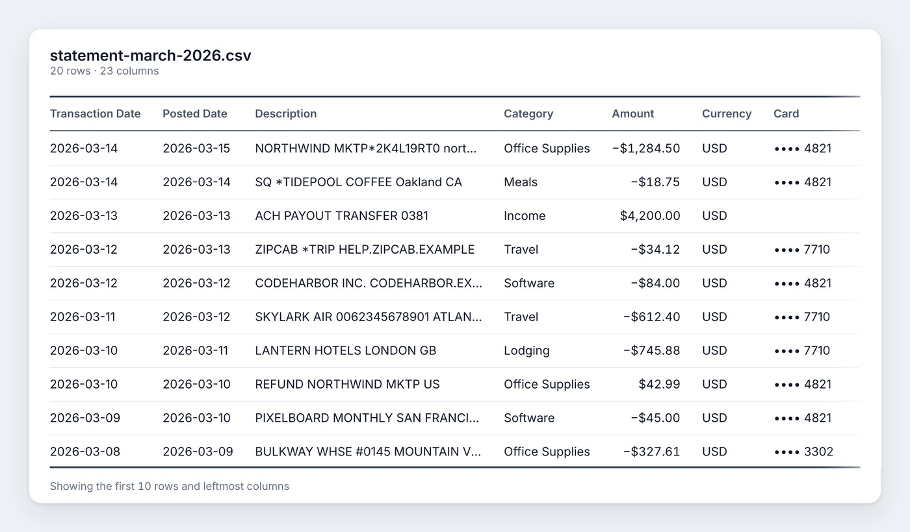
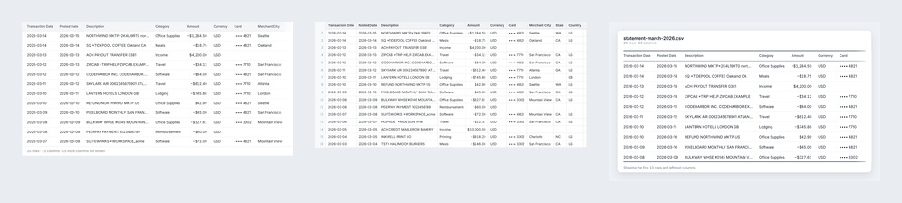

# CSV preview visual research: summary

> Screenshots of third-party products described here were captured for private reference and are not included in this repository. Each section names or links the live source instead. Mockups we rendered ourselves are in [`../design/mockups/`](../design/mockups/).

Research done 2026-11-15 to pick a visual style for the `csv_preview` gem. Two detailed reports back this page:

- [`file-preview-surfaces.md`](./file-preview-surfaces.md): how real products preview CSV and spreadsheet files (GitHub, GitLab, Hugging Face, Kaggle, Datasette, Jupyter/pandas, Google Sheets and Drive, macOS Quick Look, Dropbox, Box), with computed CSS values.
- [`designed-tables.md`](./designed-tables.md): designed data tables (great_tables/gt, Stripe, Notion, Polaris, Primer, Carbon, Datawrapper), table typography, candidate fonts with measured sizes and licences, and three design-token sets.

## What the best previews share

- A light card or plain white background, one sans font in two weights (regular and semibold).
- A header row set apart by a faint fill (`#F4F5F7` to `#F6F8FA`) and semibold, slightly smaller, muted text.
- Thin horizontal rules between rows only, much lighter than the text. Few or no vertical rules.
- Numbers right-aligned in tabular figures (every digit the same width), with the header aligned the same way. Text stays left-aligned.
- Long text cut with an ellipsis so every row keeps the same height.
- A quiet line saying how much was left out, e.g. "1,284 rows · 31 columns".

## What makes previews look cheap

- Long text that wraps and makes rows uneven (GitLab, Kaggle).
- A header that looks like any other row (GitLab, Quick Look, Box).
- A small table floating on a mostly empty page (Finder and Drive thumbnails).
- Old system fonts on heavy grey grids (Quick Look: Verdana 10px on `#DDDDDD`).
- Getting the delimiter wrong, so a semicolon file shows as one column (Dropbox).

## The thumbnail problem

At about 300px wide, all body text is unreadable and 1px rules mostly vanish. What survives: filled areas (the header band, a row-number column), full gridlines, alignment edges, and large text such as a title. Active Storage makes one preview image per file and resizes it for every size, so the same image has to be readable at about 1024px and recognisable at 300px.

## Mockups

Real Pango text rendering (the same text stack libvips uses) from a fake 23-column bank export, at 2x. The script, style settings and CSV are in [`../design/mockups/`](../design/mockups/).

**Ledger** (quiet, Stripe/Primer-like): header band, row rules only, numbers right-aligned with a true minus sign, columns that don't fit fade out, a footer with counts.

**Grid** (spreadsheet-like): row numbers, a full light grid, bold header. Fits the most columns and reads as "spreadsheet" instantly.

**Card** (document-like): filename title and counts, the table inside a rounded card on a tinted background.

**All three at 300px wide** (left to right: Ledger, Grid, Card):

## Fonts

All candidates are OFL-licensed, so they can be bundled in an MIT gem. Inter has the widest coverage (every currency symbol tested) at 333 KB per weight (130 KB as a Latin subset). Geist is the sharpest at 88 KB but lacks some currency symbols. CJK fonts are 9 to 17 MB, so Chinese and Japanese text should fall back to system fonts. Details and specimens are in `designed-tables.md`.

## libvips and Pango notes for the builder

- `vips_text` always parses its input as Pango markup: unescaped `<` or `&` makes the render fail ("invalid markup in text"), so every cell must be escaped.
- `` gives tabular figures (tested on Pango 1.58).
- `vips_text` has no ellipsis option, so the gem must measure and trim text itself, using the same font features it draws with.
- On macOS, libvips ignores `fontfile` and draws Helvetica unless `PANGOCAIRO_BACKEND=fontconfig` is set.
- Inter's ASCII hyphen under `tnum` leaves a gap before amounts; draw negative signs as a true minus (U+2212).
- Codes made only of digits (MCC, ZIP, reference IDs) should stay left-aligned, not be treated as amounts.
