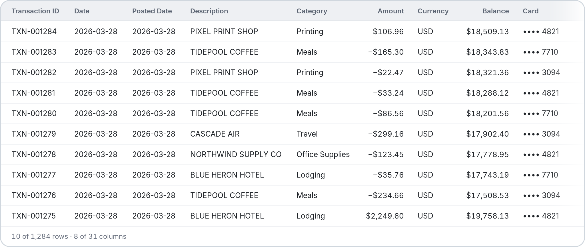

# csv_preview: branding and discoverability

- **Status:** accepted; implemented in 0.1
- **Started:** 2026-11-15
- **Conforms to:** the pinned contract in [`README.md`](./README.md) (sections 9 to 12). Rails registration, test IDs and defaults are taken from [`active-storage.md`](./active-storage.md), [`parsing-and-safety.md`](./parsing-and-safety.md) and [`rendering.md`](./rendering.md); where this document quotes them, those documents win.
- **Scope:** how the gem is positioned and named, how it looks, what the README and every metadata field say, what coding agents and AI answer engines read, which trust signals to ship, how to launch, and how to measure whether people and machines find it. Suggested edits to the overview are collected in [section 9](#9-proposed-changes-to-the-overview).

Volatile facts (registry features, list rules, crawler names) were checked on 2026-11-15 and carry a source link. Re-check them before launch.

## 0. Summary

- **Pitch:** csv_preview renders CSV files as clean preview images and makes them previewable in Rails' Active Storage, using libvips instead of LibreOffice or a headless browser.
- **Tagline:** "Beautiful CSV previews for Active Storage." Second line: "No LibreOffice, no headless browser, no network."
- **Name:** keep `csv_preview`. It is the string people and agents will type or guess, it is free on RubyGems, npm and PyPI, and brandability can come from the visual identity and the "Ledger" look instead of the name ([1.5](#15-name-evaluation)).
- **Biggest levers, in order:** (1) a README that answers the exact questions people and agents ask, in self-contained paragraphs, with a comparison table and real renders; (2) precise safety claims, each linked to a named test; (3) gemspec text written for RubyGems search, which weights name, then summary, then description ([4.2](#42-gemspec)); (4) an agent integration guide shipped inside the gem as an Agent Skill ([4.5](#45-agent-integration-guide-skillscsv-previewskillmd)); (5) third-party mentions after launch, because AI answers favour earned sources over a project's own pages ([4.1](#41-what-agents-and-answer-engines-read)).

## 1. Positioning

### 1.1 Audience

1. **Rails developers whose apps accept uploads**: expense and receipt tools, helpdesks and chat, file managers, import flows. They hit "CSV attachments have no thumbnail" or `ActiveStorage::UnpreviewableError`.
2. **Ruby developers who need a picture of a table**: bots, notification emails, reports. They search "csv to png ruby".
3. **Coding agents** asked to "add thumbnails for CSV attachments" or "render this CSV as an image". They pick a gem from what they know, what search returns, and what the registry says, then follow the README.

### 1.2 Problem framing (README-ready)

> Rails previews PDFs and videos out of the box, but a CSV attachment gets a generic file icon, and calling `preview` on it raises `ActiveStorage::UnpreviewableError`. The usual fixes bolt an office suite or a headless browser onto the app server and run it on files strangers uploaded, or send private files to a paid API. csv_preview reads only the start of the file, in Ruby, and draws a designed table with libvips, which most Rails apps already have.

Every sentence is checkable: the default previewer list is in [Active Storage's engine](https://github.com/rails/rails/blob/main/activestorage/lib/active_storage/engine.rb), the error comes from [`Blob#preview`](https://github.com/rails/rails/blob/main/activestorage/app/models/active_storage/blob/representable.rb), and Rails' generated Dockerfile adds `libvips` to its base packages whenever Active Storage is enabled (`dockerfile_base_packages` in [`app_base.rb`](https://github.com/rails/rails/blob/main/railties/lib/rails/generators/app_base.rb)).

### 1.3 Copy deck (use these strings verbatim)

AI engines resolve a project to one entity when it is described the same way everywhere, and retrieval engines cite self-contained passages. So the core strings are fixed here and reused, not paraphrased per surface.

| Item | Text | Used in |
|---|---|---|
| Name | `csv_preview` (always lowercase with the underscore; the module is `CsvPreview`) | everywhere |
| Descriptor | csv_preview is a Ruby gem that renders CSV and TSV files as preview images (PNG, JPEG or WebP) and adds an Active Storage previewer to Rails. | first sentence of the README pitch, `llms.txt` blockquote, SKILL.md, docs site, launch posts |
| Tagline | Beautiful CSV previews for Active Storage. | README line under the title, social preview, Show HN context |
| Differentiator | No LibreOffice, no headless browser, no network. | README under the tagline, social preview, comparison intro |
| Safety line | Built for untrusted uploads: it reads at most 2 MiB, stops after 5 seconds, and never runs another program or opens a network connection. | README Security intro, SECURITY.md, FAQ |
| Gem summary | Render CSV and TSV files as preview images and thumbnails (PNG, JPEG, WebP) using libvips. Includes an Active Storage previewer for Rails. | gemspec `summary` |
| GitHub description | Beautiful CSV previews for Ruby and Rails. Renders CSV and TSV files to PNG, JPEG or WebP with libvips and adds an Active Storage previewer. No LibreOffice, headless browser or network. | GitHub About |
| Look name | Ledger (the default look: "the Ledger look") | README, gallery captions, future theme docs |

Wording rules:

- Write "csv_preview" in prose, in code style where the format allows. Never "CSV Preview", "CsvPreview gem" or "csv-preview". The one exception is the Agent Skill directory, which must be `csv-preview` because the [Agent Skills spec](https://agentskills.io/specification) allows only lowercase letters, digits and hyphens in skill names.
- Repeat the name instead of "it" at the start of any paragraph that could be quoted alone (FAQ answers, README section openers). Retrieval systems lift single passages; a passage that says "It supports TSV" is useless out of context.
- Say "Active Storage" in prose and `ActiveStorage::...` in code. The description deliberately contains both forms so RubyGems search matches "activestorage" and "active storage" ([4.2](#42-gemspec)).
- Plain claims only: no "blazing", "best-in-class" or invented numbers. Numbers appear only when a test or benchmark in the repo produces them.

### 1.4 Target queries

These are the questions to answer explicitly (README FAQ, headings, blog post, SKILL.md). Grouped by intent; the right column says where the answer lives.

| Intent | Queries humans and agents use | Answered in |
|---|---|---|
| Active Storage | "rails active storage preview csv", "activestorage previewer csv", "active storage csv thumbnail", "how to make csv previewable active storage", "rails preview non-image attachments", "show thumbnail for csv attachment rails" | README Rails section, FAQ 1, blog post |
| Error text (pasted verbatim) | "ActiveStorage::UnpreviewableError text/csv", "No previewer found for blob with ID and content_type=text/csv", "No previewer found and can't transform blob" | FAQ 2 (quotes the exact messages) |
| Avoiding heavy tools | "activestorage previewer without libreoffice", "activestorage-office-previewer csv", "csv thumbnail without libreoffice", "preview uploads without imagemagick", "imagemagick policy blocks text label preview" | FAQ 3 and 6, comparison table |
| Plain Ruby | "csv to png ruby", "ruby render csv as image", "ruby csv to image", "generate table image ruby", "ruby-vips draw table", "csv to jpeg ruby" | README plain Ruby section, FAQ 4 |
| Safety | "is it safe to preview user uploaded csv", "csv preview untrusted input", "csv injection preview" | Security section, FAQ 5 and 14 |
| Choice | "best gem for csv previews rails", "csv preview gem", "ruby gem csv thumbnail" | descriptor, comparison table, third-party lists |
| Agent tasks | "Add thumbnails for CSV attachments in this Rails app", "Which Ruby gem renders a CSV file to an image?" | SKILL.md, `llms.txt`, README "For AI coding agents" |

What the queries show: the head term "csv preview" is crowded with viewers (a VS Code extension, web components, desktop apps; 52 GitHub repositories have "csv preview" in the name), so csv_preview will not win it alone. It can own the long tail that adds "rails", "active storage", "ruby", "png" or an error message. That is where the README and FAQ aim.

### 1.5 Name evaluation

Checked 2026-11-15: `csv_preview`, `csv-preview` and `csvpreview` are unregistered on RubyGems, npm and PyPI.

| Candidate | Discoverability | Guessable by an agent | Brandable | Scope fit | Verdict |
|---|---|---|---|---|---|
| **`csv_preview`** | Exact match for "csv preview"; tokens `csv` and `preview` hit RubyGems' name field (weighted 5x) | High: the obvious snake_case name, matches `CsvPreview` | Low on its own | Fits core and previewer; TSV is fine; XLSX later still fits loosely | **Keep** |
| `activestorage-csv-previewer` | Strong for Active Storage queries; mirrors `activestorage-office-previewer` | Medium | Low | Undersells plain Ruby use; long | No |
| `csv_thumbnail` | Good for "thumbnail" queries | Medium | Low | Too narrow: previews are full-size too | No |
| An invented name (`tablesnap`, `ledger`) | None until it is famous | Low | High | Any | No: discovery is the secondary goal, and "ledger" collides with accounting tools |
| `csvshot` | Weak | Low | Medium | Implies a screenshot, the look the project is avoiding | No |

Recommendation: keep `csv_preview`. Get brandability from the visual identity ([section 2](#2-visual-identity)) and from naming the default look "Ledger". Do not publish alias gems under other names; they split downloads and look like squatting.

## 2. Visual identity

### 2.1 Principles

- **The product is the brand.** Every brand image shows a real render, generated by the gem, so what people see is what they get.
- **Quiet, like the Ledger look.** Neutral greys, one accent, Inter in two weights. The accent appears only in brand assets, never in the default theme, which stays neutral.
- **Sample data, never a real statement.** People's names, card numbers and account numbers in brand and README images are always invented. Merchant names may be real, as they would appear on any statement, but the current images use invented ones ("Northwind", "Tidepool Coffee", "Skylark Air"), which also avoids trademark questions and any hint that the image is someone's real statement.

### 2.2 Palette

Neutrals are the Ledger theme's own tokens ([`rendering.md`](./rendering.md) 2.2), so brand and product match. The accent is new and brand-only.

| Token | Hex | Use | Contrast |
|---|---|---|---|
| Ink | `#1F2328` | wordmark, headings | 15.8:1 on white |
| Slate | `#5B6472` | secondary text, header labels | 5.24:1 on header fill |
| Muted | `#6B7280` | captions | 4.83:1 on white |
| Header fill | `#EEF0F3` | logo header band, canvases | |
| Rule | `#DDE1E6` / `#EDEFF2` | logo rules, borders | |
| Paper | `#FFFFFF` | card backgrounds | |
| Canvas | `#F4F5F7` | social preview and hero background | |
| Accent, "Ledger green" | `#0E7C66` | logo number bars, link colour on a future docs site | 5.13:1 on white |
| Accent on dark | `#3FB9A0` | the same, on dark backgrounds | 7.8:1 on `#0D1117` |

Green suggests ledgers and money without implying "positive numbers", since the theme never colours numbers.

### 2.3 Logo

- **Mark:** a rounded square (corner radius 22% of the side) drawn like a tiny Ledger render: white card, 1-unit border in Rule, a header band in Header fill with a darker rule under it, three body rows separated by thin rules, a left column of long grey bars (text) and a right column of short Accent bars aligned to the right edge (numbers in tabular figures). The rightmost bars fade out, echoing the Ledger fade.
- **Small sizes:** below 32 px, drop the fade and use two rows; at 16 px keep only the header band and two right-aligned accent bars. Ship hand-tuned files for 16 and 32 px instead of scaling the master.
- **Wordmark:** `csv_preview` in Inter SemiBold, Ink, with the underscore in Accent. It reads as a code identifier, which is what people type. The wordmark is a **PNG**, not an SVG: libvips cannot emit Inter's glyph outlines as SVG paths, and an SVG that referenced the font by name would draw in whatever font the viewer has instead of Inter.
- **Files:** `docs/assets/brand/mark.svg` (master, hand-written SVG), `mark-16.png`, `mark-32.png`, `mark-180.png`, `mark-512.png`, `wordmark-light.png`, `wordmark-dark.png` (771 by 156 px; the dark one swaps Ink for `#E6EDF3` and Accent for `#3FB9A0`). The mark has no text, so it stays an SVG. The PNGs are exported by the brand script ([2.4](#24-brand-images-rendered-by-the-gem)); loading our own SVG there is fine because it is a development tool, not the gem's runtime.
- **Licence:** the logo is part of the repository and MIT-licensed like everything else; say so in the README's licence section so others can use it in articles.

### 2.4 Brand images rendered by the gem

A development-only script, `bin/brand-images` (excluded from the packaged gem, alongside the golden-image tooling the roadmap already allows under `bin/`), regenerates every image below from fixtures in `test/fixtures/`. It uses `CsvPreview.render` for every table and ruby-vips for composition and headline text, so the social preview and README art are the gem's own output. It writes to `docs/assets/`:

| Output | Size | Content |
|---|---|---|
| `brand/social-preview.png` | 1280 x 640 | [2.5](#25-github-social-preview) |
| `hero.png` | render width at scale 2 (2048 x 868) | the README hero ([2.6](#26-readme-hero-gallery-and-dark-mode)): `wide_long.csv` rendered with `max_rows: 10`, and its caption says so |
| `gallery/<fixture>.png` | render width at scale 2 | one per gallery fixture other than the hero's: `numbers`, `emoji_cjk`, `simple`, `semicolon_decimal_comma` |
| `gallery/thumbnails.png` | 1280 wide | the hero's render (`max_rows: 10`) and three gallery renders cut with the thumbnail recipe at 300 px, side by side |
| `brand/mark-*.png` | 16, 32, 180, 512 | exports of the mark |
| `brand/wordmark-light.png`, `brand/wordmark-dark.png` | 771 x 156 | the wordmark for light and dark backgrounds (PNG, see 2.3) |
| `manifest.json` | n/a | every output's size, source fixture, options, caption and facts (rows and columns shown, fading column, footer), plus the gem and libvips versions that produced it; the README captions and alt text are written from it |

Rules: regenerate on every release that changes rendering; commit the outputs; the caption of each README image names the gem version and fixture that produced it ("Rendered by csv_preview 0.1.0 from `test/fixtures/wide_long.csv`") so a reader can reproduce it. They are made in the same environment as the goldens: a manually triggered CI job on the pinned ubuntu-24.04 image runs `bin/brand-images` and commits the output. Local runs are for previewing only, since macOS draws emoji and fallback fonts differently. The goldens themselves stay governed by [`rendering.md`](./rendering.md) section 11; README images may be cropped or composited from the same renders.

### 2.5 GitHub social preview

GitHub accepts PNG, JPG or GIF under 1 MB, at least 640 x 320, and recommends 1280 x 640; it warns that transparent images look different across platforms and suggests a solid background when unsure ([GitHub Docs](https://docs.github.com/en/repositories/managing-your-repositorys-settings-and-features/customizing-your-repository/customizing-your-repositorys-social-media-preview)). It is uploaded in Settings > General > Social preview.

Layout (1280 x 640, solid Canvas background, no transparency):

- **Left column** (x 80 to 560): the mark at 72 px; the wordmark at 64 px; the tagline "Beautiful CSV previews for Active Storage." in Slate at 40 px over two lines; at the bottom, "Ruby gem · libvips · no LibreOffice" in Muted at 26 px.
- **Right side:** a real Ledger render of a fictional statement export, shown as a white card that bleeds off the right and bottom edges, and the table's own fade completes inside the white card (the table is laid out 40 px short of the right edge, so the whole fade is visible and the Category column dissolves into the card rather than being cut by the canvas edge), while the card itself continues off the right and bottom edges to say "there is more data".
- **Safe area:** keep all text inside the central 1200 x 600, because some sites crop 2:1 images to about 1.91:1.
- **Checks before upload:** under 1 MB; the tagline still legible when the image is shrunk to 400 x 200 (how it appears in chat unfurls); no real company names in the table.

The same file becomes the Open Graph image of the docs site later.

### 2.6 README hero, gallery and dark mode

Ledger renders are white rectangles with a 1 px `#E3E6EA` frame and no alpha ([`rendering.md`](./rendering.md) 2.2). On GitHub's dark theme (`#0D1117`) a raw white image works but its square edge looks unfinished. Recommendation:

- **Gallery and hero images:** the brand script places each render on a transparent canvas with rounded corners (12 px at display size) and a 1 px `#D0D7DE` outline. One file then looks intentional on GitHub light, dark and dark dimmed, and on rubydoc.info's white page. No `<picture>` needed. No drop shadow: shadows look muddy on dark backgrounds.
- **Images that put text directly on the page background** (the wordmark, any banner): use `<picture>` with a `prefers-color-scheme: dark` source, which is GitHub's supported method ([GitHub blog](https://github.blog/developer-skills/github/how-to-make-your-images-in-markdown-on-github-adjust-for-dark-mode-and-light-mode/)); the older `#gh-dark-mode-only` URL fragments should not be used.
- **Absolute URLs.** README images use `https://raw.githubusercontent.com/garyhtou/csv_preview/main/docs/assets/...`. Relative paths render on GitHub but break on rubydoc.info, which builds from the packaged gem, and the images are deliberately not packaged.
- **Display size.** Set `width="720"` on the hero so it does not push the setup code below the fold; renders are made at scale 2 so they stay sharp on high-density screens.
- **Alt text that states facts.** For example: "A 31-column CSV export rendered by csv_preview: the first columns shown with amounts right-aligned, the next column fading out at the right edge, and a footer stating how many rows and columns were left out." Use the real counts of the image once it is rendered. Alt text is indexed and read by agents that cannot see the image.

Gallery (each image links to its source fixture):

1. `wide_long`: a wide bank-style export, the hero.
2. `numbers`: currencies, negatives and identifiers that stay left-aligned.
3. `emoji_cjk`: emoji, Chinese, Japanese and right-to-left text, with a note that servers need the Noto font packages ([`rendering.md`](./rendering.md) 4.8).
4. `simple`: a small table that fills the frame.
5. `semicolon_decimal_comma`: a European Excel export, showing delimiter sniffing.
6. The thumbnail strip: the hero's render (`max_rows: 10`) and the `numbers`, `emoji_cjk` and `simple` renders at 300 px with `crop: :low`, showing the header band surviving. (The strip cuts the 10-row hero render, not the 20-row `wide_long` render, because the larger crop share keeps the header band and first columns legible at 300 px.)

## 3. README blueprint

### 3.1 Section order and why

| # | Section | Contents | Why it helps humans | Why it helps search and AI answers |
|---|---|---|---|---|
| 1 | Title, tagline, badges | `# csv_preview`, tagline, differentiator, 3 badges | Instant "what and why" | The H1 and first lines are the strongest page signals; text, not an image title |
| 2 | Pitch | The descriptor plus two sentences | Confirms fit in 10 seconds | A self-contained entity definition that answer engines can quote whole |
| 3 | Hero image | Real render, factual alt text | Shows "beautiful" instead of claiming it | Alt text is indexed |
| 4 | Rails in three lines | Gemfile, `unshift`, view | Time to first preview | The most-asked question answered at the top |
| 5 | Plain Ruby in two lines | `CsvPreview.render` | Second audience | Answers "csv to png ruby" |
| 6 | Why csv_preview | Three bullets: beautiful, safe, light, each linking down | Skimmers get the case | Three clean claims, each backed further down |
| 7 | Gallery | [2.6](#26-readme-hero-gallery-and-dark-mode) | Proves quality across messy inputs | Captions name formats and features |
| 8 | Installation | Gem plus system packages for Ubuntu/Debian and macOS, Docker note, font packages, `fc-cache` for containers, `CsvPreview.text_supported?` check | Avoids the first failure | Agents copy commands from here |
| 9 | Rails usage | Registration (`unshift` or `register_previewer`), views, thumbnail recipe, `discard_on`, content types, regenerating previews, require at boot | The real integration | Matches long-tail Rails queries |
| 10 | Plain Ruby usage | `render`, `sample`, `layout`, String-is-a-path rule | Non-Rails users | Answers plain Ruby queries |
| 11 | Options | The pinned table from the overview section 9.2 | Reference | Tables are lifted well by retrieval |
| 12 | How it works | [3.4](#34-how-it-works-outline) | Builds trust in the approach | Explains the mechanism in quotable steps |
| 13 | Comparison | [3.3](#33-comparison-table) | Helps decide | Comparison tables are a favoured source for "X vs Y" and "best X" answers |
| 14 | Security | [3.6](#36-security-section) | The deciding factor for uploads | Precise, test-backed claims are the evidence engines prefer |
| 15 | Performance | Measured numbers only, with machine and method | Sets expectations | Statistics with a source |
| 16 | Compatibility | [3.5](#35-compatibility-matrix) | Answers "will it run here" | One table per question |
| 17 | FAQ | [3.7](#37-faq) | Answers objections | Question-shaped headings mirror prompts |
| 18 | For AI coding agents | Pointer to SKILL.md, a copy-paste prompt | Helps people who delegate setup | Gives agents a canonical, versioned path |
| 19 | Versioning, changelog, security policy, contributing | Links | Maintenance signals | Trust signals in plain text |
| 20 | Licence and credits | MIT for code and logo, OFL-1.1 for Inter; credits to Inter and libvips | Legal clarity | Clean licence statement |

Writing rules for the README: answer first in every section (the first 40 to 60 words state the answer, details follow); one idea per section; no "as mentioned above"; every claim either links to a test or a source or is removed; keep everything in plain Markdown (GitHub and rubydoc.info serve the text in HTML, and AI crawlers do not run JavaScript ([Vercel](https://vercel.com/blog/the-rise-of-the-ai-crawler))); no Mermaid diagrams for content that matters (they do not render on rubydoc.info).

### 3.2 Above the fold (draft)

````markdown
<p align="center">
  
</p>

<h1 align="center">csv_preview</h1>

<p align="center">
  <strong>Beautiful CSV previews for Active Storage.</strong> No LibreOffice, no headless browser, no network.
</p>

<p align="center">
  <a href="https://github.com/garyhtou/csv_preview/actions/workflows/ci.yml"></a>
  <a href="https://rubygems.org/gems/csv_preview"></a>
  <a href="LICENSE"></a>
</p>

csv_preview is a Ruby gem that renders CSV and TSV files as preview images (PNG, JPEG or WebP) and adds an Active Storage previewer to Rails. CSV attachments get thumbnails and previews the same way images, PDFs and videos do. It draws text with libvips and Pango and is built for files uploaded by strangers.



## Rails in three lines

```ruby
# Gemfile
gem "csv_preview"

# config/application.rb, inside your Application class
config.active_storage.previewers.unshift CsvPreview::ActiveStoragePreviewer
```

```erb
<%= image_tag document.file.representation(resize_to_limit: [800, 800]) if document.file.representable? %>
```

Needs libvips with Pango text support, which Rails apps usually already have. [Installation](#installation)

## Plain Ruby

```ruby
require "csv_preview"
File.binwrite("orders.png", CsvPreview.render("orders.csv"))
```
````

The registration line is the one [`active-storage.md`](./active-storage.md) section 10 specifies; if that section changes, this block changes with it. The decorative mark has empty alt text on purpose; the H1 carries the name.

### 3.3 Comparison table

Lead-in sentence: "csv_preview is for CSV and TSV files. For Word, Excel and PowerPoint files, use a LibreOffice-based previewer; the two work side by side." Fairness is part of trust, and engines tend to repeat balanced comparisons.

| | csv_preview | activestorage-office-previewer | Headless Chrome (Grover, Ferrum) | wkhtmltoimage (IMGKit, table2png) | Cloud conversion API |
|---|---|---|---|---|---|
| Previews `text/csv` out of the box | Yes, plus TSV | No: Word, Excel and PowerPoint types only ([source](https://github.com/basecamp/activestorage-office-previewer/blob/master/lib/active_storage/previewer/office_previewer.rb)) | No: you write the HTML and the previewer | No: you write the HTML and the previewer | Depends on the vendor |
| Extra system software | libvips with Pango (Rails' default image library) | LibreOffice | Chrome or Chromium (Grover also needs Node.js) | wkhtmltoimage, whose upstream repository is [archived](https://github.com/wkhtmltopdf/wkhtmltopdf) | None locally |
| Starts another process per preview | No | Yes | Yes (or a long-lived browser) | Yes | No |
| Network at render time | No | No | Only if the page loads remote assets | Only if the page loads remote assets | Yes |
| File leaves your servers | No | No | No | No | Yes |
| Hard limits on bytes read, time and output size | Built in and tested | Up to the app | Up to the app | Up to the app | Vendor limits |
| Look | Designed table: Inter, tabular figures, right-aligned numbers | First page as LibreOffice prints it | Whatever your HTML and CSS do | Whatever your HTML does, in an old WebKit | Varies |
| Cost | Free, MIT | Free, open source | Free, open source | Free, open source | Paid per conversion |

Keep cells to facts that can be checked from the linked source; re-verify before each minor release (these projects change: the office previewer shipped a hardened 0.2.0 on 2026-08-10).

### 3.4 How it works (outline)

1. **One paragraph, answer first:** "csv_preview reads the first 2 MiB of the file in Ruby, works out the encoding, delimiter and header, keeps the first 20 rows and 12 columns, measures every cell with Pango, and draws the table with libvips. Your file never reaches an image decoder, a subprocess or the network."
2. **The pipeline** as the plain-text diagram from the overview section 7 (Reader, Parser, Sample, Layout, Painter), one line per step.
3. **What makes it look designed**, five bullets from the overview section 8: header band, rules between rows only, right-aligned tabular numbers with a true minus, fade for columns that do not fit, a footer that says what was left out.
4. **Why libvips:** it is the default variant processor for new Rails apps since 7.0 and installed by Rails' generated Dockerfile; it is thread-safe; Pango gives real shaping and font fallback. It works with `Vips.block_untrusted(true)`, which recent Rails turns on process-wide.
5. **What it never does:** run a program, open a socket, evaluate a formula, parse cell text as markup, load ImageMagick, or write files.

### 3.5 Compatibility matrix

From the overview section 5; update it from CI, not by hand.

| Component | Supported | Tested in CI |
|---|---|---|
| Ruby | 3.3 or newer | 3.3, 3.4, 4.0 (see [9](#9-proposed-changes-to-the-overview), item 3) |
| Rails / Active Storage (optional) | 7.2 or newer | 7.2, 8.0, 8.1 |
| libvips | 8.12 or newer with Pango 1.44+ (8.14.2+ recommended) | Ubuntu 22.04 (8.12), Ubuntu 24.04 (8.15), macOS Homebrew (current) |
| Variant processor for resizing previews | `:vips` or `:mini_magick` (PNG must be allowed by the ImageMagick policy) | both, per [`active-storage.md`](./active-storage.md) |
| Operating systems | Linux, macOS | Ubuntu, macOS |
| Not tested | Windows, JRuby, TruffleRuby | |

### 3.6 Security section

Opening paragraph: the safety line from the copy deck. Then this table, where every row links to the test that proves it. IDs refer to [`parsing-and-safety.md`](./parsing-and-safety.md) section 11 (PS-) and [`active-storage.md`](./active-storage.md) section 9 (AS-); the README links to the test files that implement them.

| Guarantee | Precisely | Proved by |
|---|---|---|
| No subprocesses | No `system`, `spawn`, `exec`, `fork`, backticks, `IO.popen`, `Open3` or `open("\|cmd")` during any call; every fixture renders with raising guards installed | PS-25, PS-28 (source scan) |
| No image decoders on your bytes | The file's bytes are never passed to a libvips loader; only escaped cell text reaches libvips | PS-25, AS-18 |
| No network | No socket is opened; in CI a child process runs under `strace` and opens no `AF_INET`/`AF_INET6` socket | PS-26 |
| No ImageMagick | Renders with no `convert` or `magick` on `PATH` and MiniMagick unloadable | PS-27 |
| Bounded reads | At most `max_input_bytes` (default 2 MiB) is read; the caller's IO is never rewound or closed; the previewer downloads only that range where the storage service supports ranged reads | PS-19, PS-23, AS-13 |
| Bounded time | Past `timeout` (default 5 s) the call raises `CsvPreview::TimeoutExceeded` | PS-20, PS-21 |
| Bounded memory | Peak RSS growth for a 50 MB file stays under 200 MB | PS-19 |
| Bounded output | Never larger than `max_width_px` by `max_height_px` | every PS test ("renders" includes the size cap), [`rendering.md`](./rendering.md) 6.10 |
| No interpretation | Formulas shown as text; Pango markup in cells drawn literally; bidirectional control characters removed | PS-13, PS-14, PS-15 |
| No file writes | No files written outside Active Storage's own tempfile (fontconfig, outside the gem, may build its own cache on the first text draw in a process) | PS-29 |
| Errors never echo your data | Error messages never include input bytes | PS-33 |
| Thread-safe | 8 threads give byte-identical results to serial renders | PS-30, AS-20 |
| Fuzzed | At least 20,000 seeded random inputs per run | PS-31 |

Close with: a link to SECURITY.md ([5.3](#53-securitymd)), the honest limits (a blocking `read` on a caller's network stream cannot be interrupted; the final image encode can overrun `timeout` by its own duration; Pango and HarfBuzz do shape the cell text), and the recommendation to generate previews in background jobs.

### 3.7 FAQ

Each answer is one self-contained paragraph that names csv_preview, so it can be quoted alone. Headings are the questions as people type them. Drafts:

**1. How do I preview CSV files in Rails Active Storage?**
Rails ships previewers only for PDFs and videos, so CSV attachments are not previewable by default. Add the csv_preview gem, make sure libvips with Pango is installed, and add `config.active_storage.previewers.unshift CsvPreview::ActiveStoragePreviewer` to `config/application.rb`. After that, `previewable?` and `representable?` are true for `text/csv` and `text/tab-separated-values` blobs, and `blob.preview(resize_to_limit: [800, 800])` or `blob.representation(...)` returns a PNG of the first rows.

**2. Why does Active Storage raise `UnpreviewableError` ("No previewer found for blob ... content_type=text/csv")?**
Active Storage raises `ActiveStorage::UnpreviewableError` with the message "No previewer found for blob with ID=... and content_type=text/csv" when no registered previewer accepts the file, and `representation` raises `ActiveStorage::UnrepresentableError` ("No previewer found and can't transform blob") for the same reason. Rails' built-in previewers only accept PDFs and videos. Registering csv_preview's `CsvPreview::ActiveStoragePreviewer` makes CSV and TSV blobs previewable; check `representable?` before calling `representation` in views.

**3. Can I make CSV thumbnails in Rails without LibreOffice?**
Yes. csv_preview draws CSV previews with libvips and Pango inside the Ruby process, so it needs no LibreOffice, headless browser or ImageMagick and never starts another program. LibreOffice-based previewers such as activestorage-office-previewer handle Word, Excel and PowerPoint files and do not accept `text/csv`, so an app can use both: csv_preview for CSV and TSV, LibreOffice for Office documents.

**4. How do I convert a CSV file to a PNG image in Ruby?**
Call `CsvPreview.render("data.csv")`, which returns PNG bytes for the first 20 rows and up to 12 columns, and write them with `File.binwrite("data.png", png)`. Pass `format: :jpeg` or `format: :webp` for other formats and options such as `max_rows:` or `scale:` to change the output. csv_preview treats a String argument as a file path, so to render CSV text already in memory, pass `StringIO.new(text)`.

**5. Is it safe to preview CSV files that users upload?**
csv_preview is designed for untrusted uploads. It reads at most 2 MiB by default, stops after 5 seconds, caps the image size, escapes every cell before drawing, shows formulas as plain text, removes bidirectional control characters, never passes the file to an image decoder, and never runs another program or opens a network connection. Each of these guarantees has a named test listed in the README's Security section; report vulnerabilities privately as described in SECURITY.md.

**6. Does csv_preview need ImageMagick? What if my ImageMagick policy blocks TEXT, LABEL or SVG?**
No. csv_preview never uses ImageMagick or MiniMagick. It produces a PNG, a raster format that locked-down ImageMagick policies normally still allow, so apps whose variant processor is `:mini_magick` can still resize the preview. Policies that deny `TEXT`, `LABEL`, `SVG`, `MVG`, `PS`, `PDF` and every delegate do not affect csv_preview, as long as PNG is allowed.

**7. How large a CSV file can csv_preview handle?**
Any size. csv_preview reads only the first 2 MiB by default (`max_input_bytes`) and shows the first 20 data rows, so a 5 GB export costs about the same as a 3 MB one. In Rails, csv_preview downloads only that first range from storage services that support ranged reads (Disk, S3 and GCS do). When the whole file fits within the bytes read, the footer gives the exact row count; otherwise it reports what was shown without guessing a total.

**8. Does csv_preview handle TSV, semicolons, Excel exports and other encodings?**
Yes. csv_preview detects the delimiter (comma, semicolon, tab or pipe), whether the first row is a header, and the encoding, including UTF-8 with or without a byte order mark, UTF-16 and Windows-1252 files saved by Excel. Each can be set explicitly with `delimiter:`, `header_row:` and `encoding:`. Malformed rows, unbalanced quotes and ragged rows are parsed leniently instead of failing the preview.

**9. Does csv_preview support XLSX, ODS or Numbers files?**
Not yet. csv_preview reads delimited text only (CSV and TSV). Spreadsheet formats are on the roadmap as separate, opt-in readers, because each needs its own safety review for ZIP bombs and XML entity expansion. For Office files today, activestorage-office-previewer renders them with LibreOffice.

**10. What do I need to install on the server?**
csv_preview needs libvips 8.12 or newer built with Pango text support; `CsvPreview.text_supported?` returns true when it is ready. Rails' generated Dockerfile already installs libvips when Active Storage is enabled; on macOS, `brew install vips`. For emoji, Chinese, Japanese or Korean text, and scripts such as Thai and Hindi, also install `fonts-noto-color-emoji`, `fonts-noto-cjk` and `fonts-noto-core` on Debian or Ubuntu; without them those characters show as boxes but nothing fails.

**11. Can I change how previews look?**
The 0.1 release ships one look, Ledger: Inter, a tinted header band, rules between rows, right-aligned tabular numbers and a footer that says what was left out. Options change density and limits (`scale`, `max_rows`, `max_columns`, `max_width_px`), and `font:` picks a system font. More looks (Grid, Card) and token overrides are on csv_preview's roadmap.

**12. Can csv_preview make dark-mode previews?**
No. Active Storage stores one preview image per file, so csv_preview renders a light image that works on light and dark pages inside a bordered frame. A dark theme is on the roadmap for apps that call `CsvPreview.render` themselves.

**13. How fast is csv_preview?**
Publish measured numbers only, for example: "On (machine), csv_preview renders the README's 23-column sample in (N) ms warm and parses a worst-case 2 MiB file in (N) ms, median of (runs) runs with `bin/benchmark`." The spec's budgets, for orientation: a 20 by 12 table renders in under 250 ms warm on a laptop core, and parsing any 2 MiB input takes under 1 s ([`rendering.md`](./rendering.md) 10, [`parsing-and-safety.md`](./parsing-and-safety.md) 7.4).

**14. Can a cell like `=HYPERLINK(...)` or `<b>` do anything?**
No. csv_preview never evaluates cell contents: a formula is drawn as the literal text, and markup such as `<b>` or `<span>` is escaped and drawn as typed. csv_preview also never modifies or re-exports the file, so it adds no CSV injection risk; that risk applies when someone opens the original file in a spreadsheet program.

**15. Does csv_preview work with Shrine, CarrierWave or plain Ruby?**
Yes. csv_preview's core has no Rails dependency: `CsvPreview.render(io_or_path)` returns image bytes in any Ruby process, so it can run inside a Shrine derivative, a CarrierWave version, a background job or a script. Only `CsvPreview::ActiveStoragePreviewer` needs Rails.

**16. Is csv_preview thread-safe?**
Yes. csv_preview snapshots its configuration per call and keeps no shared mutable state, and libvips is thread-safe, so Puma and Sidekiq threads can render at once. Set global configuration once at boot, and require the gem at boot (Bundler does this by default). If your server or job runner forks (Puma with `preload_app!`, Resque, parallel test runners), render only in the forked children: libvips can hang in a child forked after the parent has rendered, while requiring the gem and the Railtie's boot-time warm-up before the fork are fine.

**17. What licence is csv_preview under?**
csv_preview is free and open source under the MIT licence. It bundles the Inter font under the SIL Open Font License 1.1, which allows the font to ship inside an MIT-licensed gem. There is no paid tier, account or service.

## 4. Agent-facing discoverability

### 4.1 What agents and answer engines read

| Surface | Who reads it | Evidence | What to do |
|---|---|---|---|
| Web pages via search indexes | ChatGPT search, Perplexity, Google AI Overviews, Claude with search, Copilot | Answers are assembled from retrieved passages; adding statistics, quotations and source citations raised visibility by up to 40% in the GEO study, keyword stuffing did not help ([Aggarwal et al., KDD 2024](https://arxiv.org/abs/2311.09735)) | Self-contained, evidence-backed README and FAQ passages |
| Third-party pages | Same engines | AI search shows "a systematic and overwhelming bias towards Earned media" over brand-owned content ([Chen et al., 2025](https://arxiv.org/abs/2509.08919)) | Launch posts, newsletters, lists, Stack Overflow, blog posts by others ([section 6](#6-launch-and-distribution-checklist)) |
| GitHub README | Humans, crawlers, coding agents browsing GitHub | Server-rendered HTML; AI crawlers do not run JavaScript ([Vercel](https://vercel.com/blog/the-rise-of-the-ai-crawler)) | The README is the homepage until a docs site exists |
| RubyGems.org search | Humans, agents running `gem search` or the API | Search matches `name^5`, `summary^2` and `description` with a default AND operator, then boosts by downloads ([rubygems.org source](https://github.com/rubygems/rubygems.org/blob/master/lib/elastic_searcher.rb)) | Put the words people search into the summary and description, naturally ([4.2](#42-gemspec)) |
| RubyGems.org API | Agents checking a gem before adding it | `/api/v1/gems/NAME.json` returns `info` (the description), licences, and every `*_uri` metadata link | Fill every metadata link |
| The installed gem | Agents working inside an app after `bundle add` | They read files under `bundle show csv_preview` | Package README, CHANGELOG, LICENSE and the Agent Skill ([4.6](#46-what-the-gem-package-contains)) |
| `llms.txt` | Mostly coding agents | Of 137,210 sites, 28% published one and 97% of those files got no requests in a month; among named AI fetchers, Claude Code requested it more than any AI retrieval bot ([Ahrefs, June 2026](https://ahrefs.com/blog/llmstxt-study/)) | Small file, low cost, no expectations ([4.4](#44-llmstxt)) |
| Packaged agent skills | Coding agents in projects that install them | Dart documents package skills under `skills/` ([Dart](https://dart.cn/tools/pub/package-skills)); installers for Python and JavaScript link library skills into `.agents/skills` ([Library Skills](https://library-skills.io)); no Ruby installer exists yet | Ship one SKILL.md ([4.5](#45-agent-integration-guide-skillscsv-previewskillmd)) |
| Docs indexers | Coding agents using MCP doc tools | Context7 indexes public GitHub repositories submitted at [context7.com/add-library](https://context7.com/add-library) | Submit after going public |
| API reference | Humans and agents | rubydoc.info builds YARD docs for published gems | Document every public method ([4.7](#47-yard-and-rubydocinfo)) |

### 4.2 Gemspec

RubyGems shows `summary` in `gem list -d` and recommends a description of a few plain paragraphs without examples or formatting ([specification reference](https://guides.rubygems.org/specification-reference/)). Because search requires every query word to match somewhere in name, summary or description, the text must contain the words people type: csv, tsv, preview, previewer, thumbnail(s), image, png, jpeg, webp, rails, active storage, activestorage, libvips, vips, pango, libreoffice. Written as sentences, not a keyword list.

```ruby
spec.name        = "csv_preview"
spec.version     = CsvPreview::VERSION   # set before metadata, which interpolates it
spec.summary     = "Render CSV and TSV files as preview images and thumbnails (PNG, JPEG, WebP) " \
                   "using libvips. Includes an Active Storage previewer for Rails."
spec.description = <<~TEXT.tr("\n", " ").strip
  csv_preview is a Ruby gem that renders CSV and TSV files as preview images (PNG, JPEG or WebP)
  and adds an Active Storage previewer to Rails. It turns the first rows of a file into a clean,
  readable table image: a thumbnail for a file list or a larger preview for a detail page. In Rails,
  CsvPreview::ActiveStoragePreviewer (an ActiveStorage::Previewer) makes CSV attachments work with
  blob.preview, blob.representation and previewable? the same way PDFs and videos do. It draws text
  with libvips (vips) and Pango, needs no LibreOffice, headless browser or ImageMagick, never starts
  another process or opens a network connection, and treats every file as untrusted input with
  bounded reads, memory and time.
TEXT
spec.homepage    = "https://github.com/garyhtou/csv_preview"
spec.licenses    = ["MIT", "OFL-1.1"]   # see 5.6; the overview currently says MIT only
spec.required_ruby_version = ">= 3.3"
spec.requirements << "libvips 8.12 or newer with Pango text support"

spec.metadata = {
  "homepage_uri"          => "https://github.com/garyhtou/csv_preview",
  "source_code_uri"       => "https://github.com/garyhtou/csv_preview/tree/v#{spec.version}",
  "changelog_uri"         => "https://github.com/garyhtou/csv_preview/blob/main/CHANGELOG.md",
  "documentation_uri"     => "https://rubydoc.info/gems/csv_preview/#{spec.version}",
  "bug_tracker_uri"       => "https://github.com/garyhtou/csv_preview/issues",
  "rubygems_mfa_required" => "true",
  "allowed_push_host"     => "https://rubygems.org"
}
```

Notes:

- Metadata keys and values must be Strings; link values must be http or https URLs ([specification reference](https://guides.rubygems.org/specification-reference/)). `rubygems_mfa_required` set to `"true"` makes every later version require owners to have MFA, and the gem page then shows "New versions require MFA" ([RubyGems MFA guide](https://guides.rubygems.org/setting-up-multifactor-authentication/)).
- `source_code_uri` and `documentation_uri` point at the exact version, so a reader of an old version lands on matching code and docs.
- `funding_uri` is optional; add it only if a funding page exists.
- `mailing_list_uri` and `wiki_uri` stay unset.
- No `post_install_message`: it is noise for humans and invisible to most agents.
- Switch `homepage_uri` and `documentation_uri` to the docs site once it exists.

### 4.3 GitHub About

- **Description:** the GitHub description from the copy deck (under 350 characters).
- **Website:** `https://rubydoc.info/gems/csv_preview` until a docs site exists.
- **Topics** (GitHub allows at most 20, lowercase letters, digits and hyphens, 50 characters each ([GitHub Docs](https://docs.github.com/en/repositories/managing-your-repositorys-settings-and-features/customizing-your-repository/classifying-your-repository-with-topics))): `ruby`, `ruby-gem`, `rails`, `ruby-on-rails`, `activestorage`, `active-storage`, `csv`, `tsv`, `csv-preview`, `file-preview`, `preview`, `thumbnail`, `thumbnails`, `thumbnail-generator`, `libvips`, `vips`, `pango`, `image-generation`. Two slots stay free for later (for example `xlsx` if spreadsheet input ships).
- **Sidebar:** show Releases; hide Packages and Deployments (empty sections look unfinished).
- **Releases:** a GitHub Release per tag whose notes are the CHANGELOG entry.

### 4.4 `llms.txt`

The proposal (Answer.AI, first published 2024-09-03, now v2) defines a Markdown file with a required H1, a summary blockquote, optional detail, H2 sections of links, and an "Optional" section agents may skip; it can live at a site root or a subpath ([llmstxt.org](https://llmstxt.org/)).

Verdict: **worth it, kept small.** It does nothing measurable for AI search, but its realistic audience is coding agents, it costs about 30 lines, and Ruby projects such as RubyLLM and Pagy already publish one. For the MVP, put it at the repository root (agents browsing the repo find it next to the README); when a docs site exists, serve it at the site root and add Markdown twins of each page. Link to raw Markdown (`raw.githubusercontent.com`), not GitHub's HTML pages. Keep version numbers out so it cannot go stale.

````markdown
# csv_preview

> csv_preview is a Ruby gem that renders CSV and TSV files as preview images (PNG, JPEG or WebP) and adds an Active Storage previewer to Rails. It draws text with libvips and Pango, needs no LibreOffice, headless browser or ImageMagick, and never runs another program or opens a network connection.

- Install: `bundle add csv_preview`. The system needs libvips 8.12+ with Pango; `CsvPreview.text_supported?` returns true when ready.
- Rails 7.2+: add `config.active_storage.previewers.unshift CsvPreview::ActiveStoragePreviewer` to `config/application.rb`. CSV and TSV blobs then work with `preview`, `representation` and `previewable?`.
- Plain Ruby 3.3+: `CsvPreview.render(path_or_io)` returns PNG bytes. A String is always a file path; wrap CSV text in `StringIO`.
- Bounded for untrusted uploads: reads at most 2 MiB, stops after 5 seconds by default.
- Not supported: XLSX, ODS, Numbers.

## Docs

- [README](https://raw.githubusercontent.com/garyhtou/csv_preview/main/README.md): installation, Rails and plain Ruby usage, options, security, FAQ
- [Agent integration guide](https://raw.githubusercontent.com/garyhtou/csv_preview/main/skills/csv-preview/SKILL.md): exact steps for adding csv_preview to a Rails app
- [API reference](https://rubydoc.info/gems/csv_preview)

## Project

- [Changelog](https://raw.githubusercontent.com/garyhtou/csv_preview/main/CHANGELOG.md)
- [Security policy](https://raw.githubusercontent.com/garyhtou/csv_preview/main/SECURITY.md)

## Optional

- [Specification](https://raw.githubusercontent.com/garyhtou/csv_preview/main/docs/spec/README.md)
- [Visual research](https://raw.githubusercontent.com/garyhtou/csv_preview/main/docs/research/README.md)
````

### 4.5 Agent integration guide: `skills/csv-preview/SKILL.md`

One file, written for a coding agent, that is both the "how to add this to a Rails app correctly" guide and a valid [Agent Skill](https://agentskills.io/specification). It ships inside the gem and is linked from the README and `llms.txt`. Library authors ship skills so agents use the installed version as intended instead of stale patterns from training data ([Library Skills](https://library-skills.io)). Until Ruby gets an installer, people copy or symlink the directory into `.claude/skills/` or `.agents/skills/`; agents that do not support skills read it as plain Markdown.

Frontmatter (the `name` must match the directory and use hyphens; `description` up to 1,024 characters, saying what and when):

```yaml
---
name: csv-preview
description: Add CSV and TSV previews and thumbnails to Active Storage attachments in a Rails app, or render a CSV file as a PNG, JPEG or WebP image in Ruby, using the csv_preview gem. Use when CSV attachments show no thumbnail, when preview or representation raises ActiveStorage::UnpreviewableError or UnrepresentableError for text/csv, or when someone wants a picture of a CSV table without LibreOffice, a headless browser or ImageMagick.
license: MIT
compatibility: Ruby 3.3+, libvips 8.12+ with Pango; Rails 7.2+ for the Active Storage previewer.
---
```

Body outline (under 200 lines; detail stays in the README):

1. **When not to use it:** XLSX, ODS, Numbers or other binary formats; full-file rendering; dark images.
2. **Check the environment:** Ruby and Rails versions from `Gemfile.lock`; libvips presence.
3. **Install:** `bundle add csv_preview`; system packages for Debian/Ubuntu and macOS; font packages for emoji and CJK.
4. **Verify text support:** `bin/rails runner 'puts CsvPreview.text_supported?'` must print `true`; if not, fix libvips before going on.
5. **Register:** `config.active_storage.previewers.unshift CsvPreview::ActiveStoragePreviewer` in `config/application.rb` (or `config.csv_preview.register_previewer = true`), exactly once.
6. **Background failures:** the `discard_on ActiveStorage::PreviewError` recipe from the README.
7. **Views and thumbnails:** `representation` behind `representable?`; the `crop: :low` thumbnail recipe for libvips and `gravity: "NorthWest"` for MiniMagick.
8. **Test it:** a model or system test that attaches a small CSV fixture and asserts `previewable?` and a processed preview, plus a smoke command that writes `tmp/csv_preview_check.png`.
9. **Pitfalls (do not):** pass user-supplied strings to `CsvPreview.render` (a String is a path; wrap text in `StringIO`); add `application/vnd.ms-excel` to the content types (it is binary XLS); install LibreOffice or ImageMagick for this; register the previewer twice; expect existing preview images to regenerate after an upgrade (purge and reprocess); require the gem lazily inside a request on macOS.
10. **Links:** README sections, options table, SECURITY.md.

`rake docs:check` ([4.9](#49-keeping-the-wording-consistent)) verifies the snippets in SKILL.md match the README.

For contributors (not consumers), an optional root `AGENTS.md` ([agents.md](https://agents.md)) tells agents working on the repository how to run the tests, that `lib/` may not use the forbidden APIs of [`parsing-and-safety.md`](./parsing-and-safety.md) section 9.1, and the project's writing style (prose avoids em dashes; `rake docs:check` enforces it). Cheap, and it signals the project expects agent-assisted contributions to meet the same bar.

### 4.6 What the gem package contains

`spec.files`: `lib/**/*`, `fonts/*` (including `OFL.txt`), `skills/**/*`, `README.md`, `CHANGELOG.md`, `LICENSE`, `SECURITY.md`, `.yardopts` (rubydoc.info builds from the packaged gem, so it needs `.yardopts` to render the Markdown docs; 4.7). Not `docs/`, `test/`, `bin/`, images or `llms.txt` (images would bloat the gem; `llms.txt` is for the web). Agents inside an app can then read the README, changelog and skill offline from the installed gem.

### 4.7 YARD and rubydoc.info

- A YARD comment on every public constant and method in the pinned API (overview section 9), with `@param`, `@return`, `@raise` and a short `@example`. CI runs `yard stats --list-undoc` and fails if anything public is undocumented.
- `.yardopts`: `--markup markdown --readme README.md - CHANGELOG.md SECURITY.md`.
- rubydoc.info renders the README from the packaged gem, which is another reason README images use absolute URLs. It is a community service with occasional outages (it returned a 521 error during this research), which is one reason for a docs site later.

### 4.8 Errors agents can act on

Agents read error messages and act on them. Every `CsvPreview::Error` message (which never includes input content) should name the fix and a README anchor, for example: `CsvPreview::RenderFailed: libvips cannot draw text (no Pango support). Install libvips with Pango, see https://github.com/garyhtou/csv_preview#installation`. The one-time "no text support" warning from [`active-storage.md`](./active-storage.md) should carry the same link.

### 4.9 Keeping the wording consistent

A `rake docs:check` task, run in CI, fails when:

- the descriptor from [1.3](#13-copy-deck-use-these-strings-verbatim) is missing from README.md, `llms.txt` or SKILL.md, or the gemspec summary differs from the copy deck;
- a relative link, a linked test file, or an image path in README.md, SKILL.md or `llms.txt` does not exist in the repository;
- the Rails registration line differs between README.md, SKILL.md and `llms.txt`;
- any public Markdown file contains an em dash (the project's writing style avoids them).

The README's plain Ruby example also runs as a test, so the first snippet a visitor copies is known to work.

### 4.10 Crawlers, for the docs site later

For an open-source library, being in training data is a benefit: models that already know the gem recommend it without searching. So the docs site's `robots.txt` should allow both search and training crawlers: OpenAI's `OAI-SearchBot`, `ChatGPT-User` and `GPTBot` ([OpenAI](https://developers.openai.com/api/docs/bots)); Anthropic's `Claude-SearchBot`, `Claude-User` and `ClaudeBot` ([Anthropic](https://support.claude.com/en/articles/8896518-does-anthropic-crawl-data-from-the-web-and-how-can-site-owners-block-the-crawler)); `PerplexityBot`, `Googlebot`, `Google-Extended` and `Bingbot`. Serve plain HTML (no client-side rendering of content), register the site with Google Search Console and Bing Webmaster Tools (ChatGPT and Copilot draw on Bing's index), and add `SoftwareSourceCode` JSON-LD with `codeRepository`, `programmingLanguage`, `license` and `sameAs` links to RubyGems and rubydoc.info.

## 5. Trust signals

### 5.1 What to ship

| Signal | Verdict | Cost | Why |
|---|---|---|---|
| CI badge | MVP | none | Proves tests run on every push |
| Gem version badge | MVP, after first release | none | Shows it is published and current |
| Licence badge | MVP | none | Licence at a glance |
| Coverage badge | Skip | | Enforce a minimum in CI instead; a badge adds a third-party service |
| Downloads badge | Later | | Small early numbers read as "unused" |
| Safety guarantees linked to named tests | MVP | low (tests exist anyway) | The core differentiator; claims without tests are marketing |
| SECURITY.md with private reporting | MVP | low | Required for upload-facing code ([5.3](#53-securitymd)) |
| CHANGELOG.md | MVP | low | Keep a Changelog ([5.5](#55-changelog-semver-and-support-policy)) |
| SemVer and support policy | MVP | low | Tells adopters what an upgrade means |
| CONTRIBUTING.md | MVP, short | low | Setup, tests, golden images, the no-subprocess rule |
| CODE_OF_CONDUCT.md | MVP | none | [Contributor Covenant 3.0](https://www.contributor-covenant.org/version/3/0/); completes GitHub's community profile |
| Licence clarity (MIT code, OFL font) | MVP | none | [5.6](#56-licences) |
| Two ordinary runtime dependencies | MVP, stated in README | none | `csv` (Ruby's standard CSV library) and `ruby-vips`; say it plainly |
| Trusted publishing with attestations | MVP | low | No API keys; provenance shown on RubyGems.org ([5.4](#54-releases-trusted-publishing-attestations-mfa)) |
| MFA on the owner account and `rubygems_mfa_required` | MVP | none | Shown on the gem page |
| Protected `release` environment | MVP | none | A tag alone cannot publish without approval (the required reviewer needs a public repository; until then, a `v*` tag deployment rule, 5.4) |
| Dependabot for `bundler` and `github-actions` | MVP | low | Visible maintenance. `Gemfile.lock` is git-ignored, so it proposes only requirement-widening updates and action bumps |
| Actions pinned by commit SHA, least-privilege `permissions:` | MVP | low | Supply-chain hygiene; also what Scorecard checks |
| CodeQL for Ruby | MVP, optional | none for public repos | A free static-analysis signal |
| `AGENTS.md` for contributors | MVP, optional | none | [4.5](#45-agent-integration-guide-skillscsv-previewskillmd) |
| OpenSSF Scorecard | Later | low | Its Maintained check only scores projects older than 90 days, and Code-Review penalises a solo maintainer ([checks](https://github.com/ossf/scorecard/blob/main/docs/checks.md)); run the action from day one, show the badge only once the score is 7 or higher |
| OpenSSF Best Practices badge | Later, "passing" level only | medium | Worth it after 1.0; silver and gold are overkill |
| Signed release assets (`.gem` plus Sigstore bundle on the GitHub Release, or [GitHub artifact attestations](https://github.com/actions/attest-build-provenance)) | Later | low | Satisfies Scorecard's Signed-Releases check, which reads GitHub Release assets |
| Coverage-guided fuzzing ([ruzzy](https://github.com/trailofbits/ruzzy), OSS-Fuzz) | Skip for now | high | PS-31's seeded property-based fuzz covers the parser; revisit if the parser grows |
| Old-style `gem cert` signing | Skip | | Rarely verified; superseded by Sigstore attestations |
| Signed commits and tags | Optional | low | Nice, not decisive |
| Funding link | Maintainer decision | | |

### 5.2 How the README states safety

Use the table in [3.6](#36-security-section). The pattern: state a precise, falsifiable property; link the test; state the limit honestly. "Safe" alone is never written.

### 5.3 SECURITY.md

Sections:

1. **Reporting.** Use GitHub's private vulnerability reporting (Security tab, "Report a vulnerability"), enabled in the repository settings ([GitHub Docs](https://docs.github.com/en/code-security/security-advisories/working-with-repository-security-advisories/configuring-private-vulnerability-reporting-for-a-repository)). No public issues for vulnerabilities. **Decided:** `SECURITY.md` states no response-time commitment; it says reports are handled on a best-effort basis by a volunteer maintainer.
2. **Supported versions.** The latest minor release receives security fixes (before 1.0).
3. **Disclosure.** Coordinated. Fixes ship with a GitHub Security Advisory (requesting a CVE when warranted), which feeds Dependabot alerts, plus a pull request to [rubysec/ruby-advisory-db](https://github.com/rubysec/ruby-advisory-db), which feeds `bundle audit`.
4. **Threat model (short).** Who: anyone who can upload a file. What they control: every byte of the file. Where the bytes go: csv_preview's Ruby reader and parser; then sanitised, escaped, truncated cell text goes to Pango and HarfBuzz (through libvips) for shaping; the output PNG goes to the app's variant processor and to browsers. Never: an image decoder, a subprocess, the network, `eval`, a file write. Guarantees: the table in [3.6](#36-security-section).
5. **In scope.** Crashes, hangs or memory growth past the documented bounds; markup or formula interpretation; bidi spoofing; anything that starts a process, opens a socket or writes a file; error messages that leak input.
6. **Out of scope** (report upstream, and tell us so we can mitigate): bugs inside libvips, Pango, HarfBuzz, FreeType or fontconfig; ImageMagick in the app's own variant pipeline; floods of uploads (the app's rate limiting); CSV injection when users open the original file in a spreadsheet program.

### 5.4 Releases: trusted publishing, attestations, MFA

As checked on 2026-11-15:

- **Trusted publishing** exchanges a short-lived GitHub OIDC token for a push-only RubyGems credential, so no API key exists anywhere. RubyGems documents GitHub Actions as the provider. For a brand-new gem, create a *pending* trusted publisher on your RubyGems profile with the gem name; the first successful push turns it into a normal publisher and makes you the owner ([RubyGems guide](https://guides.rubygems.org/trusted-publishing/)).
- **Attestations:** the official `rubygems/release-gem@v1` action has an `attestations` input, on by default and marked experimental, that uploads Sigstore attestations through trusted publishing ([action.yml](https://github.com/rubygems/release-gem/blob/v1/action.yml)). RubyGems.org then shows a "Built and signed on GitHub Actions" provenance panel with links to the build, source commit, workflow file and transparency log entry (see the [sigstore gem's page](https://rubygems.org/gems/sigstore) for an example). The same page shows "New versions require MFA" when `rubygems_mfa_required` is set, so the two work together. In October 2025 attested pushes briefly failed on RubyGems.org and the action fell back to pushing without attestations ([status page](https://status.rubygems.org/incidents/5r3wp6tnf5xp)); check the gem page after each release.
- **Consumer-side verification** is still early (the pure-Ruby `sigstore` gem is pre-1.0), so the README should mention provenance, not ask users to verify it.

Workflow sketch (pin each action to a commit SHA with the version in a comment):

```yaml
name: Release
on:
  push:
    tags: ["v*"]
permissions: {}
jobs:
  release:
    runs-on: ubuntu-24.04
    environment: release            # required reviewer: the maintainer
    permissions:
      contents: read                # the tag already exists, so rake release pushes nothing to GitHub
      id-token: write               # trusted publishing and attestations
    steps:
      - uses: actions/checkout@<sha> # v5
        with:
          persist-credentials: false
      - uses: ruby/setup-ruby@<sha>  # v1
        with:
          bundler-cache: true
          ruby-version: ruby
      - uses: rubygems/release-gem@<sha> # v1
```

**Why `contents: read` and `id-token: write` are enough.** The workflow is triggered by the tag, so the tag already exists when `rake release` runs; the task sees it ("Tag has already been created") and pushes nothing to GitHub, and `actions/checkout` runs with `persist-credentials: false`. Publishing authenticates to RubyGems with the OIDC token (`id-token: write`), which is also what the Sigstore attestations use. A `contents: write` grant would only widen what a compromised step could do. The shipped workflow also checks that the tag equals `CsvPreview::VERSION` before publishing.

**Environment setup order.** Create the GitHub `release` environment (Settings > Environments) with a deployment rule that limits it to `v*` tags **before** creating the pending trusted publisher on RubyGems.org: a workflow that names an environment that does not exist creates it automatically and unprotected, so the order matters. Required reviewers on an environment are available only when the repository is public (or on GitHub Enterprise); while the repository is private, the protection is the `v*` tag rule alone, and the reviewer is added when the repository goes public. The pending publisher is configured for this repository, the workflow file `release.yml` and the environment `release`.

**Owner assertion.** As of November 2026, a pending trusted publisher is valid for about 12 hours, and RubyGems.org creates the gem only if the token exchange names the account that will own it (an `owner` field holding the account's numeric ID or handle). `rubygems/release-gem` v1.4.2 and the `configure-rubygems-credentials` v2.1.0 it uses do not send that field, so `release.yml` performs the same exchange in a shell step with `owner` added and runs `release-gem` with `setup-trusted-publisher: false`. Return to the action's built-in step when it gains an owner input.

Release checklist: CHANGELOG entry dated; version bumped; `rake docs:check` green; brand images regenerated if rendering changed; tag pushed; approval given; gem page shows provenance and MFA; GitHub Release created with the CHANGELOG entry.

### 5.5 CHANGELOG, SemVer and support policy

- **CHANGELOG.md** in [Keep a Changelog 1.1.0](https://keepachangelog.com/en/1.1.0/) format: Unreleased at the top; Added, Changed, Deprecated, Removed, Fixed, Security; every release dated and linked to its compare view.
- **Versioning:** [SemVer 2.0.0](https://semver.org/spec/v2.0.0.html). Before 1.0, a breaking change bumps the minor version and gets an "Upgrading" note. The pinned API (overview section 9) is treated as stable from 0.1 except `CsvPreview::Layout`, which is documented as unstable until 1.0. **Rendered pixels are not part of the API:** any release may change how previews look; the CHANGELOG says so, and existing previews must be purged to pick it up.
- **Support policy** (README):
  - Ruby: every branch that is not end-of-life on [ruby-lang.org](https://www.ruby-lang.org/en/downloads/branches/), within the gem's floor (today 3.3, 3.4 and 4.0; 3.3 reaches end-of-life on 2027-03-31). A Ruby version is dropped only in a minor release, after its end-of-life, and noted in the CHANGELOG.
  - Rails: the floor in the overview (7.2) and every newer series; CI covers each series still listed on [rubyonrails.org/maintenance](https://rubyonrails.org/maintenance) plus the floor.
  - libvips: the floor in the overview (8.12); CI covers the oldest supported Ubuntu LTS package and Homebrew's current version.
  - Security fixes: the latest minor release.

### 5.6 Licences

- Code and brand assets: MIT (`LICENSE`).
- Bundled Inter font files: SIL Open Font License 1.1 (`fonts/OFL.txt`), which permits bundling with software under any licence.
- Proposal: `spec.licenses = ["MIT", "OFL-1.1"]` so licence scanners see both, plus a README "Licence" section that says exactly which files each covers. The overview currently lists only MIT; see [9](#9-proposed-changes-to-the-overview).

## 6. Launch and distribution checklist

### 6.1 Before the repository goes public

- [ ] MVP items of [section 7](#7-mvp-versus-later) done.
- [ ] Pre-publication review of the whole history: no secrets, no private notes, no absolute local paths, no real personal data in fixtures or images.
- [ ] Social preview uploaded; About description, website and topics set.
- [ ] Private vulnerability reporting enabled; Dependabot on.
- [ ] `release` environment created with a `v*` tag deployment rule and, once the repository is public, a required reviewer (5.4).
- [ ] Pending trusted publisher created on RubyGems.org, after the environment exists (5.4).
- [ ] README read end to end on GitHub light and dark themes, and on a phone.

### 6.2 Release day

- [ ] Tag `v0.1.0`; approve the release; confirm the RubyGems page shows the links, "Built and signed on GitHub Actions" and "New versions require MFA".
- [ ] Confirm rubydoc.info renders the README with images.
- [ ] Search RubyGems.org for "csv preview", "csv thumbnail", "active storage previewer" and "csv png"; csv_preview should appear for each.
- [ ] Post on [RubyFlow](https://rubyflow.com) (the Ruby and Rails community link log; sign in with GitHub). Lead with the problem and the picture.
- [ ] Announce on the Rails forum's [rubyonrails-talk](https://discuss.rubyonrails.org/c/rubyonrails-talk) category, whose description invites users to "announce projects".

### 6.3 First two weeks (spread out, one channel per day)

- [ ] **r/rails, then r/ruby** a few days later: read each subreddit's current rules first, say you wrote it, post the image and the three-line setup, answer every comment.
- [ ] **Newsletters:** [Short Ruby](https://newsletter.shortruby.com) takes suggestions as GitHub issues in [ShortRuby/submit](https://github.com/ShortRuby/submit). [Ruby Weekly](https://rubyweekly.com) is hand-picked by its editors and its site has no public submission form (checked 2026-11-15); a RubyFlow post and a good README are the path in, plus any contact route the newsletter itself publishes.
- [ ] **The Ruby Toolbox:** project pages exist for every gem, but categories are curated by pull request to [rubytoolbox/catalog](https://github.com/rubytoolbox/catalog): add `csv_preview` to `catalog/Graphics/image_processing.yml` (next to `ruby-vips`) and `catalog/Rails_Plugins/rails_file_uploads.yml`, run `mise run test`, open one PR.
- [ ] **awesome-rails** ([gramantin/awesome-rails](https://github.com/gramantin/awesome-rails), about 3,900 stars, active): one PR adding to the Gems section, alphabetically, in its format: `- [csv_preview](https://github.com/garyhtou/csv_preview) - A gem to render CSV previews and thumbnails for Active Storage. [:red_circle:](https://rubygems.org/gems/csv_preview)`.
- [ ] **libvips community:** a short "show and tell" post in the [libvips](https://github.com/libvips/libvips) or [ruby-vips](https://github.com/libvips/ruby-vips) GitHub Discussions, with the Pango lessons learned (escaping, tabular figures, the macOS fontconfig switch). Upstream maintainers and users are exactly the audience that shares technical work.
- [ ] **Context7:** submit the public repository at [context7.com/add-library](https://context7.com/add-library).
- [ ] **Tutorial blog post** ([6.4](#64-content)) on a domain you control, then the Stack Overflow Q&A ([6.5](#65-stack-overflow-and-forum-threads)).

**Later, when eligible:** [awesome-ruby](https://github.com/markets/awesome-ruby) requires at least 30k downloads, active maintenance, stability, docs and tests, and one link per PR in the form `[csv_preview](https://github.com/garyhtou/csv_preview) - Render CSV files as preview images, with an Active Storage previewer for Rails.`, in "Image Processing" (next to ruby-vips and image_processing) ([contributing rules](https://github.com/markets/awesome-ruby/blob/master/CONTRIBUTING.md)).

### 6.4 Content

1. **Tutorial:** "How to preview CSV files in Active Storage without LibreOffice". Answer first (the three lines), then: why Rails cannot preview CSV by default (quote the error), how previewers work (`accept?`, `preview`, the ordered list), how to write a minimal one yourself, why csv_preview is safer than doing it by hand, thumbnails that keep the header, background jobs and `discard_on`. Includes renders and the comparison table. Host on a domain you control (not Medium) so it is the canonical source; link it from the README.
2. **Technical post (the Hacker News candidate):** "Drawing a good-looking table with libvips and Pango": escaping Pango markup, tabular figures and the true minus, measuring and ellipsising text yourself, the fade, why 1 px rules vanish in thumbnails, the macOS `PANGOCAIRO_BACKEND` trap, bounding untrusted input. Concrete numbers from the spec's experiments make it citable.
3. **Short demo video** (later): 60 seconds from `bundle add` to a thumbnail, with a descriptive title and transcript. Video pages are a frequently cited source type in AI answers.

Existing pages on the topic that an engine reads today (none covers CSV, which is the gap): the GoRails episode on writing a previewer ([2018, PowerPoint](https://gorails.com/episodes/how-to-create-an-active-storage-previewer)), AppSignal's custom previewers article ([2025, audio waveforms](https://blog.appsignal.com/2025/08/13/extend-activestorage-for-ruby-on-rails-with-custom-previewers.html)), and activestorage-office-previewer's README. Cite them in the tutorial; a polite note to an author when csv_preview genuinely helps their readers is fine, mass outreach is not.

### 6.5 Stack Overflow and forum threads

Searched through the Stack Exchange API on 2026-11-15: **no existing Stack Overflow question asks how to preview CSV files in Active Storage.** Adjacent questions are about PDFs. So:

- **Plan:** a self-answered, canonical question (Stack Overflow [encourages](https://stackoverflow.com/help/self-answer) answering your own question), "How do I show a thumbnail or preview for a CSV attachment in Active Storage?". The answer must solve the problem on its own (explain previewers, show a minimal custom previewer) and mention csv_preview as one option **with the affiliation disclosed**, as Stack Overflow's [self-promotion rules](https://stackoverflow.com/help/promotion) require.
- **Existing threads, ranked by fit** (answer only with something new and complete, disclosed, never a bare plug):
  1. [What is the proper way to preview a file (image or pdf) using active storage?](https://stackoverflow.com/questions/59005518) (about 2,800 views): the asker hit `UnpreviewableError`; a fit only for an answer that explains `previewable?`/`representable?` and previewers in general.
  2. [ActiveStorage::UnpreviewableError](https://stackoverflow.com/questions/71668339) (about 1,400 views): PDF-specific; low fit.
  3. [What are the different content_type for Active Storage?](https://stackoverflow.com/questions/62062454) (about 3,900 views): the asker wants per-type icons; previews instead of icons is tangential. Probably skip.
  4. Rails forum: [How to set up a separate image processing server (avoid ImageMagick's many security vulnerabilities)](https://discuss.rubyonrails.org/t/how-to-set-up-a-separate-image-processing-server-avoid-imagemagicks-many-security-vulnerabilities/82081) (2023): on-topic for "processing untrusted files safely"; only if the reply adds real value.
- **Watch for new questions:** subscribe to the `rails-activestorage` tag feed (`https://stackoverflow.com/feeds/tag/rails-activestorage`) and answer CSV-related ones quickly.

### 6.6 Show HN

Rules ([Show HN](https://news.ycombinator.com/showhn.html), [guidelines](https://news.ycombinator.com/newsguidelines.html)): it must be something you made that people can try, ideally without sign-ups; no blog posts or landing pages under the Show HN label; be around to answer; never ask anyone to upvote or comment.

- **When:** a gem qualifies if it is easy to try. Either wait for the command-line tool on the roadmap, or give a one-liner in the first comment: `gem install csv_preview && ruby -rcsv_preview -e 'File.binwrite("out.png", CsvPreview.render(ARGV[0]))' your.csv`.
- **Title:** plain and specific, for example "Show HN: CSV previews for Rails, drawn with libvips instead of LibreOffice". No superlatives, no exclamation marks.
- **Link:** the GitHub repository (for Show HN) or, as a separate regular submission on another day, the technical post. Not both on the same day.
- **Timing:** Tuesday to Thursday, around the start of the US working day (roughly 14:00 to 17:00 UTC); be at the keyboard for the next three hours. Community analysis of ranking and norms: [hacker-news-undocumented](https://github.com/minimaxir/hacker-news-undocumented).
- **First comment:** why it exists, what was hard (Pango escaping, thumbnails, bounding hostile input), what it does not do, what feedback you want.
- **If it does not take off:** do not delete and repost; one honest resubmission days later is acceptable, or ask the moderators.

### 6.7 Do not

- Ask anyone to upvote, star or comment anywhere.
- Post the same text to several communities on the same day.
- Answer Stack Overflow questions with a link and no solution, or without disclosing authorship.
- Claim numbers that no test or benchmark in the repository produces.
- Use real people's data, or a real account's statement, in images.

## 7. MVP versus later

**Must ship with 0.1:**

1. README per [section 3](#3-readme-blueprint): pitch, hero, three-line Rails setup, gallery, installation, usage, options, how it works, comparison table, security table linked to tests, compatibility matrix, FAQ, "For AI coding agents".
2. Gemspec summary, description, licences, `requirements` and all metadata keys from [4.2](#42-gemspec); package contents from [4.6](#46-what-the-gem-package-contains).
3. GitHub About: description, website, topics; social preview image rendered by the gem.
4. `bin/brand-images` and its committed outputs: mark, wordmarks, hero, gallery, thumbnail strip, social preview.
5. Badges: CI, gem version, licence.
6. SECURITY.md with private vulnerability reporting enabled.
7. CHANGELOG.md (Keep a Changelog), the SemVer and support policy in the README.
8. CONTRIBUTING.md and CODE_OF_CONDUCT.md.
9. Release workflow with trusted publishing and attestations, `rubygems_mfa_required`, a protected `release` environment; Dependabot; actions pinned by SHA.
10. `llms.txt` at the repository root.
11. `skills/csv-preview/SKILL.md`, shipped in the gem.
12. YARD docs for the whole public API, `.yardopts`, undocumented-API check in CI.
13. `rake docs:check` in CI; the plain Ruby README example runs as a test.
14. Actionable error messages with README links ([4.8](#48-errors-agents-can-act-on)).

Cheap extras worth doing in 0.1 if time allows: CodeQL, the Scorecard action without a badge, `AGENTS.md`.

**Later:**

- Docs site (GitHub Pages or a custom domain) with server-rendered pages, `/llms.txt` and Markdown twins, JSON-LD, `robots.txt` per [4.10](#410-crawlers-for-the-docs-site-later), Search Console and Bing Webmaster Tools.
- Tutorial and technical blog posts; Show HN (with the CLI or the one-liner).
- Context7 submission; Ruby Toolbox and awesome-rails PRs; awesome-ruby at 30k downloads.
- Scorecard badge (after 90 days and a score of 7+); OpenSSF Best Practices "passing".
- Signed release assets on GitHub Releases.
- Demo video.
- Downloads badge once numbers are meaningful.
- Move `homepage_uri` and `documentation_uri` to the docs site.
- Install SKILL.md through a Ruby skills installer if one appears.

## 8. Measuring it

### 8.1 AI answer checks

**Cadence:** monthly for the first six months, then quarterly. Each prompt three times per engine, in a fresh chat (answers are not deterministic). Keep the log outside the repository: it changes every month and is not project documentation.

**Engines:** ChatGPT with search, Perplexity, Google (AI Overviews and AI Mode are different surfaces), Gemini, Claude with web search, Microsoft Copilot.

**Prompts:**

1. How do I preview CSV files in Rails Active Storage?
2. My Rails app raises ActiveStorage::UnpreviewableError for text/csv. How do I fix it?
3. How can I generate thumbnails for CSV uploads in Rails without LibreOffice?
4. What's the best Ruby gem to render a CSV file as an image?
5. How do I convert a CSV to a PNG in Ruby?
6. Is there an Active Storage previewer for CSV files?
7. activestorage-office-previewer alternatives for CSV
8. Is it safe to generate previews of user-uploaded CSV files in Rails?
9. What is csv_preview? (entity check)
10. csv_preview vs LibreOffice for Active Storage previews

**Scoring each answer:** (a) csv_preview mentioned; (b) recommended first; (c) install steps correct (gem plus libvips with Pango); (d) registration line correct; (e) no invented options or methods; (f) states the differentiator (no LibreOffice, bounded, safe for uploads); (g) links the repository, RubyGems or the docs. A good answer to prompt 1 reads roughly: "Use the csv_preview gem: add it to your Gemfile, make sure libvips is installed, and add `config.active_storage.previewers.unshift CsvPreview::ActiveStoragePreviewer`. Then `preview` and `representation` work for CSV files, with no LibreOffice needed." Failure modes to watch: recommending a LibreOffice previewer for CSV, hand-rolled ImageMagick text drawing, invented gem names, or outdated registration code.

**Expectations:** search-backed engines can surface the gem within weeks of being indexed and mentioned elsewhere; models' built-in knowledge only changes with later training cutoffs, which takes months or more. Track the trend: visibility rate = share of prompt runs that mention csv_preview.

### 8.2 Coding-agent check

Quarterly, in a fresh Rails app with one model that has `has_one_attached :file`, ask Claude Code, Cursor and GitHub Copilot's agent: "Add thumbnails for CSV attachments." Score: did it choose csv_preview unprompted; did it find and follow SKILL.md or the README; does `bin/rails test` pass; did it avoid the pitfalls in [4.5](#45-agent-integration-guide-skillscsv-previewskillmd). Then repeat with "Use the csv_preview gem" to test the integration path alone. File issues against the docs for every mistake an agent makes; those mistakes are what the next agent will make too.

### 8.3 GitHub and RubyGems signals

- **GitHub traffic:** Insights > Traffic shows views, unique visitors, referring sites and popular content for the last 14 days only ([GitHub Docs](https://docs.github.com/en/repositories/viewing-activity-and-data-for-your-repository/viewing-traffic-to-a-repository)). Snapshot it weekly through the REST API (`/repos/{owner}/{repo}/traffic/views`, `/traffic/popular/referrers`) from a scheduled job. Referrers such as `chatgpt.com`, `perplexity.ai`, `news.ycombinator.com` and `google.com` show which channels work; much AI-driven traffic arrives with no referrer, so treat that number as a floor.
- **GitHub adoption:** stars (trend, not total), the "Used by" dependents graph, issues and discussions opened by people you do not know.
- **RubyGems:** total and per-version downloads (`/api/v1/gems/csv_preview.json`, `/api/v1/versions/csv_preview.json`) and reverse dependencies (`/api/v1/gems/csv_preview/reverse_dependencies.json`). CI systems and mirrors inflate downloads, so watch the slope after each launch step.
- **The Ruby Toolbox:** the project's score and category rank once listed.
- **Search:** run the [1.4](#14-target-queries) queries in a private window on Google and Bing monthly; once a docs site exists, use Search Console and Bing Webmaster Tools instead.

## 9. Proposed changes to the overview

> **Status: applied** to the overview on 2026-11-15 (items 1 to 5; `spec.licenses` is `["MIT", "OFL-1.1"]`). Item 6: the mockups were regenerated with fictional merchants. Item 7: the test IDs in `parsing-and-safety.md` now agree. Kept below for the reasoning.

1. **Section 11 (MVP), README contents.** Extend the README list to: pitch, hero render, three-line Rails setup, gallery, installation, Rails and plain Ruby usage, options, how it works, comparison table, security table linked to named tests, compatibility matrix, FAQ, "For AI coding agents". Add to the MVP: SECURITY.md, CHANGELOG.md, CONTRIBUTING.md, CODE_OF_CONDUCT.md, `llms.txt`, `skills/csv-preview/SKILL.md`, the release workflow with trusted publishing, Dependabot, `bin/brand-images` and the social preview, `rake docs:check`.
2. **Section 12 (Packaging).** Add the gemspec text and metadata of [4.2](#42-gemspec) (summary and description wording, every `*_uri`, `rubygems_mfa_required`, `requirements`), the `spec.files` list of [4.6](#46-what-the-gem-package-contains), and consider `spec.licenses = ["MIT", "OFL-1.1"]` since the gem bundles OFL fonts. Note that README images are the golden renders composited by `bin/brand-images` and use fictional data.
3. **Section 5 (Environment), Ruby in CI.** Ruby 4.0 was released on 2025-12-25 and is in normal maintenance; CI should cover 3.3, 3.4 and 4.0, not only the floor.
4. **Section 2 (Why it exists), fairness and sources.** activestorage-office-previewer is maintained (0.2.0, 2026-08-10) and was hardened (scrubbed environment for LibreOffice, active content disabled); it does not accept `text/csv`. Reword the LibreOffice bullet to "built for Office formats, not CSV; requires LibreOffice and a subprocess per preview", and either source "a history of memory-safety bugs" (for example LibreOffice's [security advisories page](https://www.libreoffice.org/about-us/security/advisories/)) or soften it to "a long list of security advisories". Public docs should not carry unsourced claims about another project.
5. **Section 10 (Code layout).** Add `skills/csv-preview/SKILL.md`, `llms.txt`, `SECURITY.md`, `CHANGELOG.md`, `CONTRIBUTING.md`, `CODE_OF_CONDUCT.md`, `docs/assets/` (brand and gallery images), `bin/brand-images` (development only, not packaged), `.yardopts`, `.github/workflows/release.yml` and `.github/dependabot.yml`.
6. **Mockup data.** An early `docs/design/mockups/statement.csv` used real merchant names. **Decided:** real merchant names are fine; people's names, card numbers and account numbers are always fictional (overview section 14). The mockups, the `statement.csv` fixture and the brand images now use invented merchants anyway.
7. **Cross-section note for `parsing-and-safety.md`.** Its section 9.2 table cites PS-22 to PS-26 for the side-effect proofs, while its section 11 numbers them PS-25 to PS-29 (PS-22 there is binary input). The README's security table links by ID, so the IDs need to agree; this document uses the section 11 numbering.

## 10. Open questions

1. **Docs domain:** GitHub Pages under the maintainer's account, or a dedicated domain (stronger entity signal, a small yearly cost)?
2. **Accent colour:** is "Ledger green" `#0E7C66` right, or should the brand stay fully neutral?
3. **Licences field:** list `["MIT", "OFL-1.1"]`, or keep `["MIT"]` and explain the font licence only in the README?
4. ~~SECURITY.md response target~~ **Decided 2026-11-15:** no response-time commitment.
5. **Show HN timing:** launch at 0.1 with the one-liner, or wait for the command-line tool?
6. **Funding:** add GitHub Sponsors and `funding_uri`, or not?

## 11. Sources

Checked 2026-11-15.

- RubyGems: [trusted publishing](https://guides.rubygems.org/trusted-publishing/), [specification reference](https://guides.rubygems.org/specification-reference/), [MFA](https://guides.rubygems.org/setting-up-multifactor-authentication/), [release-gem action.yml](https://github.com/rubygems/release-gem/blob/v1/action.yml), [search query source](https://github.com/rubygems/rubygems.org/blob/master/lib/elastic_searcher.rb), [attestation adoption tracker](https://segiddins.github.io/are-we-attested-yet), [status incident, October 2025](https://status.rubygems.org/incidents/5r3wp6tnf5xp), [example provenance panel](https://rubygems.org/gems/sigstore)
- GitHub: [social preview](https://docs.github.com/en/repositories/managing-your-repositorys-settings-and-features/customizing-your-repository/customizing-your-repositorys-social-media-preview), [topics](https://docs.github.com/en/repositories/managing-your-repositorys-settings-and-features/customizing-your-repository/classifying-your-repository-with-topics), [dark-mode images](https://github.blog/developer-skills/github/how-to-make-your-images-in-markdown-on-github-adjust-for-dark-mode-and-light-mode/), [private vulnerability reporting](https://docs.github.com/en/code-security/security-advisories/working-with-repository-security-advisories/configuring-private-vulnerability-reporting-for-a-repository), [traffic](https://docs.github.com/en/repositories/viewing-activity-and-data-for-your-repository/viewing-traffic-to-a-repository), [artifact attestations](https://github.com/actions/attest-build-provenance)
- Rails: [Active Storage engine (default previewers)](https://github.com/rails/rails/blob/main/activestorage/lib/active_storage/engine.rb), [`Blob::Representable`](https://github.com/rails/rails/blob/main/activestorage/app/models/active_storage/blob/representable.rb), [generator adds libvips to the Dockerfile](https://github.com/rails/rails/blob/main/railties/lib/rails/generators/app_base.rb), [maintenance policy](https://rubyonrails.org/maintenance), [Ruby branches](https://www.ruby-lang.org/en/downloads/branches/)
- Agents and AI search: [llms.txt proposal](https://llmstxt.org/), [Ahrefs llms.txt study](https://ahrefs.com/blog/llmstxt-study/), [Agent Skills specification](https://agentskills.io/specification), [Dart package skills](https://dart.cn/tools/pub/package-skills), [Library Skills](https://library-skills.io), [Context7](https://context7.com/add-library), [GEO paper](https://arxiv.org/abs/2311.09735), [earned-media bias paper](https://arxiv.org/abs/2509.08919), [Vercel on AI crawlers](https://vercel.com/blog/the-rise-of-the-ai-crawler), [OpenAI crawlers](https://developers.openai.com/api/docs/bots), [Anthropic crawlers](https://support.claude.com/en/articles/8896518-does-anthropic-crawl-data-from-the-web-and-how-can-site-owners-block-the-crawler), [AGENTS.md](https://agents.md)
- Trust: [OpenSSF Scorecard](https://securityscorecards.dev/) and [its checks](https://github.com/ossf/scorecard/blob/main/docs/checks.md), [OpenSSF Best Practices](https://www.bestpractices.dev), [Keep a Changelog](https://keepachangelog.com/en/1.1.0/), [SemVer](https://semver.org/spec/v2.0.0.html), [Contributor Covenant 3.0](https://www.contributor-covenant.org/version/3/0/), [ruby-advisory-db](https://github.com/rubysec/ruby-advisory-db)
- Distribution: [awesome-ruby contributing rules](https://github.com/markets/awesome-ruby/blob/master/CONTRIBUTING.md), [awesome-rails](https://github.com/gramantin/awesome-rails), [Ruby Toolbox catalog](https://github.com/rubytoolbox/catalog), [RubyFlow](https://rubyflow.com), [Short Ruby submissions](https://github.com/ShortRuby/submit), [Ruby Weekly](https://rubyweekly.com), [Show HN rules](https://news.ycombinator.com/showhn.html), [HN guidelines](https://news.ycombinator.com/newsguidelines.html), [hacker-news-undocumented](https://github.com/minimaxir/hacker-news-undocumented), [Stack Overflow self-promotion rules](https://stackoverflow.com/help/promotion)
- Alternatives: [activestorage-office-previewer source](https://github.com/basecamp/activestorage-office-previewer/blob/master/lib/active_storage/previewer/office_previewer.rb), [wkhtmltopdf (archived)](https://github.com/wkhtmltopdf/wkhtmltopdf), [Grover](https://github.com/Studiosity/grover), [Ferrum](https://github.com/rubycdp/ferrum)
